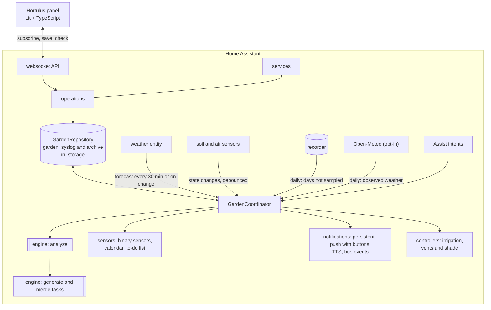

<!-- Generated from the sources by a script: code excerpts below are verbatim. -->
<p align="center"></p>

# Hortulus — architecture blueprint

> **Hortulus** (`garden_manager`) is a Home Assistant custom integration plus a sidebar
> panel for planning and running a vegetable garden. This blueprint is the single
> technical reference: architecture, data model, algorithms, APIs, UI and tests. It describes
> **integration version 2.2.0** (storage schema 1.8). All code excerpts are copied verbatim
> from the repository; follow the file links for the full implementation.
> Nederlandstalige gebruikersdocumentatie staat in [`docs/nl`](nl/).

**Contents**

1. [Overview](#1-overview)
2. [Architecture & Folder Tree](#2-architecture--folder-tree)
3. [Data Model](blueprint/03-data-model.md#3-data-model)
4. [Backend (Python)](blueprint/04-backend-python.md#4-backend-python)
5. [Frontend (TypeScript)](blueprint/05-frontend-typescript.md#5-frontend-typescript)
6. [Services, Entities, and Events](blueprint/06-services-entities-and-events.md#6-services-entities-and-events)
7. [Scheduling, Compatibility, and Watering Algorithms](blueprint/07-scheduling-compatibility-and-watering-algorithms.md#7-scheduling-compatibility-and-watering-algorithms)
8. [Example HA Automations & Dashboards](blueprint/08-example-ha-automations--dashboards.md#8-example-ha-automations--dashboards)
9. [Tests](blueprint/09-tests.md#9-tests)
10. [Documentation Files (README etc.)](blueprint/10-documentation-files-readme-etc.md#10-documentation-files-readme-etc)
11. [Version 1.1 additions and release map](blueprint/11-version-11-additions-and-release-map.md#11-version-11-additions-and-release-map)

---

## 1. Overview

| Requirement | Where it lives |
|---|---|
| Drag‑and‑drop planner in five steps (site, growing zones, beds, perennials, annuals; single/block/row; succession; companion overlay; import/export; undo/redo, snap, tooltips, shortcuts) and the per‑year garden plan | `frontend/src/views/planner-view.ts` (mode `planner` / `layout`), `frontend/src/planner/*` |
| Read‑only "look at a garden" view (used by the separate Hortulus website) | `frontend/src/views/garden-viewer.ts`, `panel.config.tabs` |
| Plant database (232 crops, EN/NL/FR, user overrides & custom plants) | `custom_components/garden_manager/data/plants.json`, `engine/plantdb.py` |
| Companion scoring, rotation, greenhouse suitability, coverage (what covers what on the site plan) | `engine/compatibility.py`, `engine/schedule.py`, `engine/weather.py`, `engine/coverage.py` |
| Task engine (generation, recurrence, completion, postpone cascade, priorities, durations, notes, photos, seasonal work, weather episodes, pest calendar, eco tips) | `engine/tasks.py`, `engine/maintenance.py`, `engine/weather_tasks.py`, `engine/pests.py`, `engine/eco.py`, `operations.py` |
| Sensors + forecast (frost, heat, irrigation, GDD, water balance learning from moisture sensors) | `engine/weather.py`, `engine/watering.py`, `engine/waterbalance.py`, `coordinator.py` |
| Climate history and statistics (daily log of outdoor weather and every temperature sensor, gap filling from the recorder and Open‑Meteo, months kept for good, measured frost dates; used by growth, water, disease and tasks) | `engine/climate.py`, `climate_history.py`, `coordinator.py`, `frontend/src/components/climate-history.ts` |
| Hardware: irrigation (pump interlock, valve timers, lost‑valve and leak detection, valve test), greenhouse vent/shade | `controllers.py`, `engine/irrigation.py` |
| HA entities, services, events, notifications (digest, reminders, phone buttons), Assist | `sensor.py`, `binary_sensor.py`, `calendar.py`, `todo.py`, `button.py`, `number.py`, `select.py`, `switch.py`, `services.py`, `notifications.py`, `actions.py`, `voice.py` |
| Config flow + options flow, more than one garden | `config_flow.py`, `options.py`, `seed.py`, `gardens.py` |
| Storage with versioning & migrations, system log (undo), season archive | `storage.py`, `engine/migrations.py`, `engine/syslog.py`, `engine/archive.py`, `engine/seasons.py` |
| Records, kitchen, cost and harvest, planning help, season report, analysis (diagnosis, "why not here?", plan compare) | `engine/records.py`, `engine/kitchen.py`, `engine/planning.py`, `engine/diagnose.py` |
| Cooking: seasonal cookbook, menus, fridge ideas, own recipes, shopping list, PDFs | `engine/cooking.py`, `engine/cooking_dishes.py`, `engine/cooking_extras.py`, `frontend/src/views/cooking-view.ts` |
| Advice, Q&A assistant, handbook, glossary, supplies | `engine/advisor.py`, `engine/qa.py`, `engine/qa_kb.py`, `engine/handbook.py`, `engine/supplies.py` |
| Printing: maps, sheets, plant cards, year plan, season book (PDF/SVG) | `engine/pdf.py`, `engine/printout.py`, `engine/seasonbook.py`, `printing.py` |
| Plan import/export | `engine/planio.py` |
| Trilingual (EN/NL/FR) | `translations/*.json`, `strings.json`, `engine/i18n.py`, `engine/texts_garden.py`, `frontend/src/i18n/*`, `data/handbook/{en,nl,fr}`, `data/sentences/{en,nl,fr}` |
| Brand (name, logo, icon, banner) & design system | `assets/brand/*`, [`DESIGN_SYSTEM.md`](DESIGN_SYSTEM.md) |

**Design tenets**

* **Pure engine, thin HA shell.** All horticultural logic lives in
  `engine/` – plain Python on the standard library only, no Home Assistant imports, no
  network or hardware I/O (the only file reads are the bundled plant database and
  handbook) – so it is fast to test and identical whether triggered by a sensor, a service
  call or the panel. The same engine also runs outside Home Assistant (see
  [2.2](#22-one-engine-two-hosts-home-assistant-and-the-browser)).
* **Event‑driven.** Sensors are never polled: the coordinator listens to state changes of
  exactly the mapped entities (debounced 10 s). Only the forecast is fetched on a timer
  (30 min) or when the weather entity updates (≥ 10 min apart).
* **Explainable advice.** Every warning, wait and task carries an i18n key + parameters
  so both the backend (notifications, calendar) and the panel can explain *why*.
* **Idempotent tasks.** Generated tasks have stable keys; regeneration never duplicates
  work or loses user decisions.
* **Local only.** No external services by default (Open‑Meteo enrichment – forecast and observed
  daily history – is opt‑in; the
  browser may fetch Wikipedia photos, on by default, switchable per browser); data in
  `.storage/garden_manager.garden` (+ `.syslog`, `.archive`), one set per garden.
* **Everything is undoable and explainable.** Every change to the garden document is
  diffed into the system log and can be reverted per entry; refused actions are logged
  with their reason.

<p align="center"></p>

---

## 2. Architecture & Folder Tree

```
greenhouse/                                  ← repository (brand: Hortulus)
├── README.md · README.nl.md · README.fr.md · CHANGELOG.md · CONTRIBUTING.md · LICENSE · hacs.json · pyproject.toml · requirements_test.txt
├── .github/workflows/ci.yml                 ← 5 jobs: ruff + pytest, tsc + node:test + bundle check, Playwright click‑through, hassfest, HACS
├── .github/workflows/release.yml            ← new version in manifest.json on main → tag vX.Y.Z + GitHub release (CHANGELOG section, garden_manager.zip)
├── assets/brand/                            ← icon, logo, dark logo, banner (SVG sources + PNG renders)
├── blueprints/automation/hortulus/          ← HA automation blueprints: frost_flash_light, button_log_harvest, water_when_dry, urgent_task_announce
├── custom_components/garden_manager/
│   ├── __init__.py          setup/unload per config entry (= per garden), GardenRuntime, daily rollover, digest / reminder / irrigation schedules
│   ├── manifest.json        domain, version 2.2.0, deps (http, frontend, panel_custom, websocket_api, persistent_notification, image_upload)
│   ├── const.py             constants, events, service names
│   ├── config_flow.py       guided setup (region → weather → areas+sensors → notifications → summary) + options; a second entry = a second garden
│   ├── options.py           options ⇄ stored settings
│   ├── seed.py              build the first garden (+ example plan) from the wizard answers
│   ├── gardens.py           more than one garden: storage key per entry, `pick()` by entry id / title, switcher listing
│   ├── coordinator.py       DataUpdateCoordinator: forecast fetch, state tracking, analysis, task merge, climate history (sampling + daily gap filling), archive trigger
│   ├── climate_history.py   recorder states → daily min / max / time‑weighted mean per entity (°C, km/h) for the climate history
│   ├── storage.py           versioned Store + repository (debounced saves, revision, system log, season archive)
│   ├── operations.py        write operations shared by services, websocket, calendar & todo (validation, undo, cookbook, plans)
│   ├── services.py · services.yaml          21 services; admin‑only set; optional `garden:` on every call
│   ├── websocket_api.py     panel API (69 commands under `garden_manager/`: subscribe, plan/*, plants/*, records/*, cooking/*, climate/*, …)
│   ├── notifications.py     persistent / push / TTS / bus events, de‑duplicated, with phone action buttons
│   ├── actions.py           handler for `mobile_app_notification_action` (Done / Tomorrow / Water now / Close valve)
│   ├── voice.py             six Assist intents + `install_voice_sentences`
│   ├── panel.py             static path + sidebar panel + Lovelace card registration (content‑hashed URLs)
│   ├── printing.py          authenticated PDF/SVG view, private export folder with signed links, photo loader for the season book
│   ├── entity.py            base entities, per‑bed/zone devices, dynamic entity creation
│   ├── sensor.py · binary_sensor.py · calendar.py · todo.py · button.py · diagnostics.py
│   ├── number.py · select.py · switch.py   irrigation limits/mode, shading mode, auto irrigation
│   ├── controllers.py       IrrigationController (pump interlock, valve timers, lost‑valve + leak watch, valve test) and ClimateController (vent/shade)
│   ├── api.py               optional Open‑Meteo client (opt‑in): forecast and observed daily history
│   ├── strings.json · translations/{en,nl,fr}.json · icons.json
│   ├── data/plants.json     plant database (232 crops, names/tips EN/NL/FR; built by scripts/build_plantdb.py + plantdb_extra.py)
│   ├── data/handbook/{en,nl,fr}/NN-<id>.md · glossary.json   23 handbook chapters per language + tooltip glossary
│   ├── data/sentences/{en,nl,fr}/hortulus.yaml   Assist sentences (copied to /config/custom_sentences by a service)
│   ├── frontend/hortulus-panel.js · hortulus-card.js   built bundles (committed): panel and Lovelace tasks card
│   └── engine/              ← pure Python (standard library only), no HA imports – see 4.14 for the module catalogue
│       ├── models.py serde.py region.py plantdb.py geometry.py coverage.py        data model and geometry
│       ├── schedule.py compatibility.py succession.py phenology.py                 timing, companions, rotation
│       ├── weather.py watering.py waterbalance.py irrigation.py                    forecast, ET₀, moisture, plans
│       ├── climate.py                                                              climate history, statistics, frost dates
│       ├── tasks.py maintenance.py weather_tasks.py pests.py eco.py fertilizer.py   tasks and seasonal work
│       ├── analysis.py diagnose.py advisor.py qa.py qa_kb.py supplies.py           orchestration, explanation, advice
│       ├── records.py kitchen.py planning.py                                        journal, harvest, costs, seeds, forecasts
│       ├── seasons.py archive.py syslog.py migrations.py planio.py                  per‑season plans, archive, undo, versions, import/export
│       ├── cooking.py cooking_dishes.py cooking_extras.py                           seasonal cookbook
│       ├── pdf.py printout.py seasonbook.py handbook.py                             documents
│       ├── i18n.py texts_garden.py                                                  backend message catalogue (EN/NL/FR)
│       └── slogans.py                                                               garden sayings (EN/NL/FR, by theme and season), picked per day and place
├── frontend/                ← Lit + TypeScript sources (esbuild), dev harness, tests
│   ├── build.mjs · package.json · tsconfig.json
│   ├── src/hortulus-panel.ts            root element, menu (places + tabs), routing, subscription, garden switcher, theme, toasts
│   ├── src/api.ts · src/types.ts        typed websocket client (garden_id aware) mirroring engine/models.py
│   ├── src/views/                       dashboard, planner (also the garden‑plan mode), crops (+ planning), library, calendar, weather,
│   │                                    journal, cooking, advice, analysis, handbook, print, settings, wall, garden‑viewer (read‑only)
│   ├── src/components/                  hl-modal, task-ui, plant-detail, plant-image, year-transition, plan-compare, season-report,
│   │                                    crop-gantt, harvest-years, quick-harvest, quick-note, photo-timeline, water-chart,
│   │                                    kitchen-economy, dish-picture, chapter-art, garden-icons, date-input, info, markdown,
│   │                                    climate-history
│   ├── src/planner/{garden-canvas,geometry,history,coverage,plant-glyphs}.ts
│   ├── src/card/                        Lovelace card `custom:hortulus-tasks-card`
│   ├── src/styles/{tokens,palettes}.ts  design tokens (light/dark) + colour themes + shared component styles
│   ├── src/util/                        dates, entities (drop‑downs), people, photos, reasons, theme, tools, celebrate, garden
│   ├── src/i18n/{en,nl,fr,index}.ts     catalogues (keys shared with the backend)
│   ├── test/*.test.ts                   node:test unit tests (11 files)
│   ├── test-ui/smoke.mjs                Playwright click‑through of the real panel
│   └── dev/                             browser harness with a mock `hass` fed by the real engine (make_snapshot.py, data‑{en,nl}.json)
├── tests/                   ← pytest (+ pytest-homeassistant-custom-component)
│   ├── conftest.py · fixtures/{forecast_hourly_dst_frost,forecast_hourly_rain,forecast_daily,sensors}.json
│   ├── engine/test_*.py     26 engine suites (tasks, frost, compatibility, agronomy, climate, planning, cooking, seasons, archive, syslog, …)
│   └── test_config_flow.py · test_init.py · test_phase2.py · test_blueprints.py
├── scripts/                 build_plantdb.py · plantdb_extra.py (plant database), render_blueprint.py (this document)
├── examples/{automations,dashboard}.yaml
└── docs/  BLUEPRINT.md (contents + chapters 1–2) · blueprint/ (chapters 3–11) · _blueprint.template.md · DESIGN_SYSTEM.md · en/{CONFIGURATION,ENTITY_REFERENCE,FAQ}.md · nl/{CONFIGURATIE,ENTITEITEN,FAQ}.md · images/
```

### 2.1 Runtime architecture



One config entry is one garden: each has its own repository, coordinator, notifier and
controllers (`GardenRuntime`). Services, websocket commands, the print view and the Assist
intents are registered once per Home Assistant and find the garden through `gardens.pick`
(`garden_id` in websocket commands, `garden:` in services; the first garden without either).

### 2.2 One engine, two hosts: Home Assistant and the browser

The engine is plain Python on the standard library, and the data layer around it is kept
thin on purpose, so the **separate Hortulus website** can run the same code in the browser
(Pyodide) next to the same `hortulus-panel` bundle. Three modules form the boundary:

| Module | May import from `homeassistant` | Why |
|---|---|---|
| `engine/*` | nothing | pure rules, shared by every host |
| `storage.py`, `operations.py`, `websocket_api.py` | only `homeassistant.components`, `.core`, `.exceptions`, `.helpers`, `.helpers.dispatcher`, `.helpers.storage`, `.util` | the website supplies stand‑ins for exactly these modules (a `Store`, a websocket connection, `dt_util`, …) and runs the real command handlers and write operations against them |

`tests/test_init.py::test_the_website_runtime_gets_the_homeassistant_modules_it_has_stubs_for`
parses those three files and fails on any other `homeassistant.*` import, because a new import
there would break the web app and not Home Assistant's own tests. Consequences for the code:

* anything the web runtime cannot offer is passed in or guarded (for example
  `POLICY_CONTROL = "control"` is a local constant because the website has no
  `homeassistant.auth`; `cooking/send` has a `dry_run` that only returns the text because
  the website mails it itself);
* the panel is host‑agnostic: `panel.config` may carry `tabs` (the subset to show; an empty list
  shows nothing), `viewer` and `web`; Home Assistant passes none of them and gets every tab;
* the plan file format (`engine/planio.py`) is the exchange format: an export from the
  website imports into Home Assistant and back, including site elements and season layouts.

The website itself (accounts, sharing, hosting) is not part of this repository.

### 2.3 Why Lit (and not React)

Home Assistant's frontend is built from Lit web components. A Lit panel receives the same
`hass` object, inherits HA theme variables through CSS custom properties, can use
`ha-icon`, and ships without a second framework runtime (the panel bundle is ≈ 0.9 MB
minified, ≈ 250 kB gzipped – most of it the three text catalogues, plant glyphs and
illustrations; the Lovelace card is a separate 27 kB file).
Drag‑and‑drop uses **pointer events with pointer capture** rather than HTML5 DnD, because
HTML5 DnD does not work on touch devices and offers poor keyboard accessibility; a full
keyboard path (Enter to place, arrows to move, Alt+arrows to resize) complements it.

---

