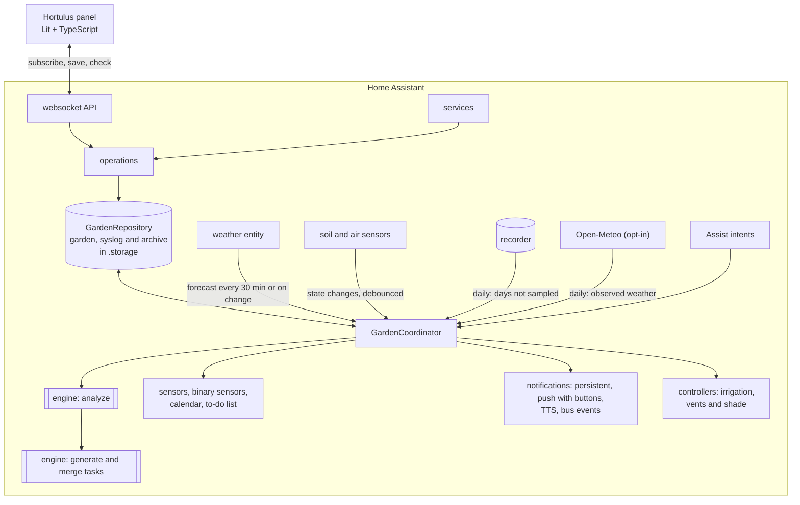

<!-- Generated from the sources by a script: code excerpts below are verbatim. -->
<p align="center"></p>

# Hortulus — architecture blueprint

> **Hortulus** (`garden_manager`) is a Home Assistant custom integration plus a sidebar
> panel for planning and running a vegetable garden. This blueprint is the single
> technical reference: architecture, data model, algorithms, APIs, UI and tests. It describes
> **integration version 2.2.0** (storage schema 1.8). All code excerpts are copied verbatim
> from the repository; follow the file links for the full implementation.
> Nederlandstalige gebruikersdocumentatie staat in [`docs/nl`](nl/).

**Contents**

1. [Overview](#1-overview)
2. [Architecture & Folder Tree](#2-architecture--folder-tree)
3. [Data Model](#3-data-model)
4. [Backend (Python)](#4-backend-python)
5. [Frontend (TypeScript)](#5-frontend-typescript)
6. [Services, Entities, and Events](#6-services-entities-and-events)
7. [Scheduling, Compatibility, and Watering Algorithms](#7-scheduling-compatibility-and-watering-algorithms)
8. [Example HA Automations & Dashboards](#8-example-ha-automations--dashboards)
9. [Tests](#9-tests)
10. [Documentation Files (README etc.)](#10-documentation-files-readme-etc)
11. [Version 1.1 additions and release map](#11-version-11-additions-and-release-map)

---

## 1. Overview

| Requirement | Where it lives |
|---|---|
| Drag‑and‑drop planner in five steps (site, growing zones, beds, perennials, annuals; single/block/row; succession; companion overlay; import/export; undo/redo, snap, tooltips, shortcuts) and the per‑year garden plan | `frontend/src/views/planner-view.ts` (mode `planner` / `layout`), `frontend/src/planner/*` |
| Read‑only "look at a garden" view (used by the separate Hortulus website) | `frontend/src/views/garden-viewer.ts`, `panel.config.tabs` |
| Plant database (232 crops, EN/NL/FR, user overrides & custom plants) | `custom_components/garden_manager/data/plants.json`, `engine/plantdb.py` |
| Companion scoring, rotation, greenhouse suitability, coverage (what covers what on the site plan) | `engine/compatibility.py`, `engine/schedule.py`, `engine/weather.py`, `engine/coverage.py` |
| Task engine (generation, recurrence, completion, postpone cascade, priorities, durations, notes, photos, seasonal work, weather episodes, pest calendar, eco tips) | `engine/tasks.py`, `engine/maintenance.py`, `engine/weather_tasks.py`, `engine/pests.py`, `engine/eco.py`, `operations.py` |
| Sensors + forecast (frost, heat, irrigation, GDD, water balance learning from moisture sensors) | `engine/weather.py`, `engine/watering.py`, `engine/waterbalance.py`, `coordinator.py` |
| Climate history and statistics (daily log of outdoor weather and every temperature sensor, gap filling from the recorder and Open‑Meteo, months kept for good, measured frost dates; used by growth, water, disease and tasks) | `engine/climate.py`, `climate_history.py`, `coordinator.py`, `frontend/src/components/climate-history.ts` |
| Hardware: irrigation (pump interlock, valve timers, lost‑valve and leak detection, valve test), greenhouse vent/shade | `controllers.py`, `engine/irrigation.py` |
| HA entities, services, events, notifications (digest, reminders, phone buttons), Assist | `sensor.py`, `binary_sensor.py`, `calendar.py`, `todo.py`, `button.py`, `number.py`, `select.py`, `switch.py`, `services.py`, `notifications.py`, `actions.py`, `voice.py` |
| Config flow + options flow, more than one garden | `config_flow.py`, `options.py`, `seed.py`, `gardens.py` |
| Storage with versioning & migrations, system log (undo), season archive | `storage.py`, `engine/migrations.py`, `engine/syslog.py`, `engine/archive.py`, `engine/seasons.py` |
| Records, kitchen, cost and harvest, planning help, season report, analysis (diagnosis, "why not here?", plan compare) | `engine/records.py`, `engine/kitchen.py`, `engine/planning.py`, `engine/diagnose.py` |
| Cooking: seasonal cookbook, menus, fridge ideas, own recipes, shopping list, PDFs | `engine/cooking.py`, `engine/cooking_dishes.py`, `engine/cooking_extras.py`, `frontend/src/views/cooking-view.ts` |
| Advice, Q&A assistant, handbook, glossary, supplies | `engine/advisor.py`, `engine/qa.py`, `engine/qa_kb.py`, `engine/handbook.py`, `engine/supplies.py` |
| Printing: maps, sheets, plant cards, year plan, season book (PDF/SVG) | `engine/pdf.py`, `engine/printout.py`, `engine/seasonbook.py`, `printing.py` |
| Plan import/export | `engine/planio.py` |
| Trilingual (EN/NL/FR) | `translations/*.json`, `strings.json`, `engine/i18n.py`, `engine/texts_garden.py`, `frontend/src/i18n/*`, `data/handbook/{en,nl,fr}`, `data/sentences/{en,nl,fr}` |
| Brand (name, logo, icon, banner) & design system | `assets/brand/*`, [`DESIGN_SYSTEM.md`](DESIGN_SYSTEM.md) |

**Design tenets**

* **Pure engine, thin HA shell.** All horticultural logic lives in
  `engine/` – plain Python on the standard library only, no Home Assistant imports, no
  network or hardware I/O (the only file reads are the bundled plant database and
  handbook) – so it is fast to test and identical whether triggered by a sensor, a service
  call or the panel. The same engine also runs outside Home Assistant (see
  [2.2](#22-one-engine-two-hosts-home-assistant-and-the-browser)).
* **Event‑driven.** Sensors are never polled: the coordinator listens to state changes of
  exactly the mapped entities (debounced 10 s). Only the forecast is fetched on a timer
  (30 min) or when the weather entity updates (≥ 10 min apart).
* **Explainable advice.** Every warning, wait and task carries an i18n key + parameters
  so both the backend (notifications, calendar) and the panel can explain *why*.
* **Idempotent tasks.** Generated tasks have stable keys; regeneration never duplicates
  work or loses user decisions.
* **Local only.** No external services by default (Open‑Meteo enrichment – forecast and observed
  daily history – is opt‑in; the
  browser may fetch Wikipedia photos, on by default, switchable per browser); data in
  `.storage/garden_manager.garden` (+ `.syslog`, `.archive`), one set per garden.
* **Everything is undoable and explainable.** Every change to the garden document is
  diffed into the system log and can be reverted per entry; refused actions are logged
  with their reason.

<p align="center"></p>

---

## 2. Architecture & Folder Tree

```
greenhouse/                                  ← repository (brand: Hortulus)
├── README.md · README.nl.md · README.fr.md · CHANGELOG.md · CONTRIBUTING.md · LICENSE · hacs.json · pyproject.toml · requirements_test.txt
├── .github/workflows/ci.yml                 ← 5 jobs: ruff + pytest, tsc + node:test + bundle check, Playwright click‑through, hassfest, HACS
├── .github/workflows/release.yml            ← new version in manifest.json on main → tag vX.Y.Z + GitHub release (CHANGELOG section, garden_manager.zip)
├── assets/brand/                            ← icon, logo, dark logo, banner (SVG sources + PNG renders)
├── blueprints/automation/hortulus/          ← HA automation blueprints: frost_flash_light, button_log_harvest, water_when_dry, urgent_task_announce
├── custom_components/garden_manager/
│   ├── __init__.py          setup/unload per config entry (= per garden), GardenRuntime, daily rollover, digest / reminder / irrigation schedules
│   ├── manifest.json        domain, version 2.2.0, deps (http, frontend, panel_custom, websocket_api, persistent_notification, image_upload)
│   ├── const.py             constants, events, service names
│   ├── config_flow.py       guided setup (region → weather → areas+sensors → notifications → summary) + options; a second entry = a second garden
│   ├── options.py           options ⇄ stored settings
│   ├── seed.py              build the first garden (+ example plan) from the wizard answers
│   ├── gardens.py           more than one garden: storage key per entry, `pick()` by entry id / title, switcher listing
│   ├── coordinator.py       DataUpdateCoordinator: forecast fetch, state tracking, analysis, task merge, climate history (sampling + daily gap filling), archive trigger
│   ├── climate_history.py   recorder states → daily min / max / time‑weighted mean per entity (°C, km/h) for the climate history
│   ├── storage.py           versioned Store + repository (debounced saves, revision, system log, season archive)
│   ├── operations.py        write operations shared by services, websocket, calendar & todo (validation, undo, cookbook, plans)
│   ├── services.py · services.yaml          21 services; admin‑only set; optional `garden:` on every call
│   ├── websocket_api.py     panel API (69 commands under `garden_manager/`: subscribe, plan/*, plants/*, records/*, cooking/*, climate/*, …)
│   ├── notifications.py     persistent / push / TTS / bus events, de‑duplicated, with phone action buttons
│   ├── actions.py           handler for `mobile_app_notification_action` (Done / Tomorrow / Water now / Close valve)
│   ├── voice.py             six Assist intents + `install_voice_sentences`
│   ├── panel.py             static path + sidebar panel + Lovelace card registration (content‑hashed URLs)
│   ├── printing.py          authenticated PDF/SVG view, private export folder with signed links, photo loader for the season book
│   ├── entity.py            base entities, per‑bed/zone devices, dynamic entity creation
│   ├── sensor.py · binary_sensor.py · calendar.py · todo.py · button.py · diagnostics.py
│   ├── number.py · select.py · switch.py   irrigation limits/mode, shading mode, auto irrigation
│   ├── controllers.py       IrrigationController (pump interlock, valve timers, lost‑valve + leak watch, valve test) and ClimateController (vent/shade)
│   ├── api.py               optional Open‑Meteo client (opt‑in): forecast and observed daily history
│   ├── strings.json · translations/{en,nl,fr}.json · icons.json
│   ├── data/plants.json     plant database (232 crops, names/tips EN/NL/FR; built by scripts/build_plantdb.py + plantdb_extra.py)
│   ├── data/handbook/{en,nl,fr}/NN-<id>.md · glossary.json   23 handbook chapters per language + tooltip glossary
│   ├── data/sentences/{en,nl,fr}/hortulus.yaml   Assist sentences (copied to /config/custom_sentences by a service)
│   ├── frontend/hortulus-panel.js · hortulus-card.js   built bundles (committed): panel and Lovelace tasks card
│   └── engine/              ← pure Python (standard library only), no HA imports – see 4.14 for the module catalogue
│       ├── models.py serde.py region.py plantdb.py geometry.py coverage.py        data model and geometry
│       ├── schedule.py compatibility.py succession.py phenology.py                 timing, companions, rotation
│       ├── weather.py watering.py waterbalance.py irrigation.py                    forecast, ET₀, moisture, plans
│       ├── climate.py                                                              climate history, statistics, frost dates
│       ├── tasks.py maintenance.py weather_tasks.py pests.py eco.py fertilizer.py   tasks and seasonal work
│       ├── analysis.py diagnose.py advisor.py qa.py qa_kb.py supplies.py           orchestration, explanation, advice
│       ├── records.py kitchen.py planning.py                                        journal, harvest, costs, seeds, forecasts
│       ├── seasons.py archive.py syslog.py migrations.py planio.py                  per‑season plans, archive, undo, versions, import/export
│       ├── cooking.py cooking_dishes.py cooking_extras.py                           seasonal cookbook
│       ├── pdf.py printout.py seasonbook.py handbook.py                             documents
│       ├── i18n.py texts_garden.py                                                  backend message catalogue (EN/NL/FR)
│       └── slogans.py                                                               garden sayings (EN/NL/FR, by theme and season), picked per day and place
├── frontend/                ← Lit + TypeScript sources (esbuild), dev harness, tests
│   ├── build.mjs · package.json · tsconfig.json
│   ├── src/hortulus-panel.ts            root element, menu (places + tabs), routing, subscription, garden switcher, theme, toasts
│   ├── src/api.ts · src/types.ts        typed websocket client (garden_id aware) mirroring engine/models.py
│   ├── src/views/                       dashboard, planner (also the garden‑plan mode), crops (+ planning), library, calendar, weather,
│   │                                    journal, cooking, advice, analysis, handbook, print, settings, wall, garden‑viewer (read‑only)
│   ├── src/components/                  hl-modal, task-ui, plant-detail, plant-image, year-transition, plan-compare, season-report,
│   │                                    crop-gantt, harvest-years, quick-harvest, quick-note, photo-timeline, water-chart,
│   │                                    kitchen-economy, dish-picture, chapter-art, garden-icons, date-input, info, markdown,
│   │                                    climate-history
│   ├── src/planner/{garden-canvas,geometry,history,coverage,plant-glyphs}.ts
│   ├── src/card/                        Lovelace card `custom:hortulus-tasks-card`
│   ├── src/styles/{tokens,palettes}.ts  design tokens (light/dark) + colour themes + shared component styles
│   ├── src/util/                        dates, entities (drop‑downs), people, photos, reasons, theme, tools, celebrate, garden
│   ├── src/i18n/{en,nl,fr,index}.ts     catalogues (keys shared with the backend)
│   ├── test/*.test.ts                   node:test unit tests (11 files)
│   ├── test-ui/smoke.mjs                Playwright click‑through of the real panel
│   └── dev/                             browser harness with a mock `hass` fed by the real engine (make_snapshot.py, data‑{en,nl}.json)
├── tests/                   ← pytest (+ pytest-homeassistant-custom-component)
│   ├── conftest.py · fixtures/{forecast_hourly_dst_frost,forecast_hourly_rain,forecast_daily,sensors}.json
│   ├── engine/test_*.py     26 engine suites (tasks, frost, compatibility, agronomy, climate, planning, cooking, seasons, archive, syslog, …)
│   └── test_config_flow.py · test_init.py · test_phase2.py · test_blueprints.py
├── scripts/                 build_plantdb.py · plantdb_extra.py (plant database), render_blueprint.py (this document)
├── examples/{automations,dashboard}.yaml
└── docs/  BLUEPRINT.md (contents + chapters 1–2) · blueprint/ (chapters 3–11) · _blueprint.template.md · DESIGN_SYSTEM.md · en/{CONFIGURATION,ENTITY_REFERENCE,FAQ}.md · nl/{CONFIGURATIE,ENTITEITEN,FAQ}.md · images/
```

### 2.1 Runtime architecture



One config entry is one garden: each has its own repository, coordinator, notifier and
controllers (`GardenRuntime`). Services, websocket commands, the print view and the Assist
intents are registered once per Home Assistant and find the garden through `gardens.pick`
(`garden_id` in websocket commands, `garden:` in services; the first garden without either).

### 2.2 One engine, two hosts: Home Assistant and the browser

The engine is plain Python on the standard library, and the data layer around it is kept
thin on purpose, so the **separate Hortulus website** can run the same code in the browser
(Pyodide) next to the same `hortulus-panel` bundle. Three modules form the boundary:

| Module | May import from `homeassistant` | Why |
|---|---|---|
| `engine/*` | nothing | pure rules, shared by every host |
| `storage.py`, `operations.py`, `websocket_api.py` | only `homeassistant.components`, `.core`, `.exceptions`, `.helpers`, `.helpers.dispatcher`, `.helpers.storage`, `.util` | the website supplies stand‑ins for exactly these modules (a `Store`, a websocket connection, `dt_util`, …) and runs the real command handlers and write operations against them |

`tests/test_init.py::test_the_website_runtime_gets_the_homeassistant_modules_it_has_stubs_for`
parses those three files and fails on any other `homeassistant.*` import, because a new import
there would break the web app and not Home Assistant's own tests. Consequences for the code:

* anything the web runtime cannot offer is passed in or guarded (for example
  `POLICY_CONTROL = "control"` is a local constant because the website has no
  `homeassistant.auth`; `cooking/send` has a `dry_run` that only returns the text because
  the website mails it itself);
* the panel is host‑agnostic: `panel.config` may carry `tabs` (the subset to show; an empty list
  shows nothing), `viewer` and `web`; Home Assistant passes none of them and gets every tab;
* the plan file format (`engine/planio.py`) is the exchange format: an export from the
  website imports into Home Assistant and back, including site elements and season layouts.

The website itself (accounts, sharing, hosting) is not part of this repository.

### 2.3 Why Lit (and not React)

Home Assistant's frontend is built from Lit web components. A Lit panel receives the same
`hass` object, inherits HA theme variables through CSS custom properties, can use
`ha-icon`, and ships without a second framework runtime (the panel bundle is ≈ 0.9 MB
minified, ≈ 250 kB gzipped – most of it the three text catalogues, plant glyphs and
illustrations; the Lovelace card is a separate 27 kB file).
Drag‑and‑drop uses **pointer events with pointer capture** rather than HTML5 DnD, because
HTML5 DnD does not work on touch devices and offers poor keyboard accessibility; a full
keyboard path (Enter to place, arrows to move, Alt+arrows to resize) complements it.

---

## 3. Data Model

All models are dataclasses in [`engine/models.py`](../custom_components/garden_manager/engine/models.py)
serialised by [`engine/serde.py`](../custom_components/garden_manager/engine/serde.py)
(unknown keys ignored, missing keys defaulted, enums/dates as ISO strings). The frontend
mirrors them in [`frontend/src/types.ts`](../frontend/src/types.ts).

Conventions: lengths in **cm**, temperatures **°C**, rain **mm**; canvas origin top‑left;
planting coordinates relative to their bed; calendar dates local, timestamps tz‑aware; a
*season* is named after the year its spring falls in (southern hemisphere: July → June).

### 3.1 Layout: `Zone`, `GardenBed`, sensor mapping

```python
{{py:custom_components/garden_manager/engine/models.py::SensorMapping}}


{{py:custom_components/garden_manager/engine/models.py::Microclimate}}


{{py:custom_components/garden_manager/engine/models.py::Zone}}


{{py:custom_components/garden_manager/engine/models.py::GardenBed}}
```

Zone types: `outdoor`, `greenhouse`, `cold_frame` (the two *enclosed* types have their own
climate and sensors), `orchard`, `fruit`, `herbs`, `flowers`, `garden` (ornamental),
`containers` (planters & pots) and `food_forest` (seven layers, see `engine/eco.py`).
Beds in the non‑enclosed types use the outdoor sensors. Bed kinds: `in_ground`, `raised`,
`container` (potting mix). Besides the sensor and shade fields shown above, a bed holds the
valve data the controller needs: `irrigation_entity`, `irrigation_flow_lpm` (entered),
`measured_flow_lpm` (learned from the water meter; `flow_lpm` prefers the entered value) and
`valve_max_min` (the valve's own safety timer: longer runs are split into openings that stay inside it).

Non‑growing **elements** are `Feature`s (`id`, `name`, `type`, position, size, notes) with 29
types, grouped in the planner as buildings & paving (house, carport, shed, driveway, parking,
street, terrace, decking, wall), paths (gravel `path`, stone, wood, bark, stepping stones),
green (lawn, flowerbed, hedge, shrub, tree, pond) and outdoor living (seating, pool, play,
fence, trellis, compost, water butt, beehive, other). `engine/coverage.py` (mirrored by
`frontend/src/planner/coverage.ts`) decides what covers what: solid elements and growing zones
take their area away from a ground cover underneath (lawn, terrace, border …) in the map, the
print and the m² shown; a tree or shrub takes nothing.

**Plans per season.** The garden plan (zones, beds, elements – no plants) is stored per
season. The plan of `layout_season` lives in `GardenData.zones/beds/features` and is the garden
as it is now (entities, tasks and irrigation work with it); other seasons are
`GardenLayout`s in `GardenData.layouts` (`{season: layout}`). Plans set aside with *start a new
plan* are `ArchivedPlan`s (layout + the plantings it held). Nothing carries into a new
year by itself: a `Planting` belongs to its own `season` and to the seasons it was moved into
at the year‑end transition (`last_season`), see 4.16.

### 3.2 `Plant`

Sowing windows are **weeks relative to a frost anchor**, which makes one database work on
both hemispheres and in every climate.

```python
{{py:custom_components/garden_manager/engine/models.py::Window}}


{{py:custom_components/garden_manager/engine/models.py::GreenhouseProfile}}


{{py:custom_components/garden_manager/engine/models.py::CompanionLink}}


{{py:custom_components/garden_manager/engine/models.py::CareRule}}


{{py:custom_components/garden_manager/engine/models.py::Plant}}
```

The built‑in database (`data/plants.json`, ≈ 600 kB, generated by `scripts/build_plantdb.py`
from compact profile rows plus `scripts/plantdb_extra.py`) holds **232 crops** –
vegetables, herbs, fruit (trees, soft, cane and vine fruit), companion flowers and green
manures – with `names`, `tips` and companion `reason`s in **EN, NL and FR**, Kc per stage,
N‑P‑K demand, height, root depth, yield and plants per person, pollination, harvest windows,
icon/colour/emoji and 178 companion relations. Relations are stored once and made symmetric at load
(*enemy wins* when two sources disagree), with a family‑level fallback. User data layers on top:
`custom_plants` (full `Plant`s, `source: "custom"`) and `plant_overrides` (a sparse patch per
built‑in plant, deep‑merged, `source: "override"`; language dictionaries add up per language and
extra sowing windows are kept).

A database entry (excerpt of `data/plants.json`):

```json
{{lines:custom_components/garden_manager/data/plants.json::5::31}}
    …
```

### 3.3 `Planting`

```python
{{py:custom_components/garden_manager/engine/models.py::Planting}}
```

### 3.4 `Task`

```python
{{py:custom_components/garden_manager/engine/models.py::Recurrence}}


{{py:custom_components/garden_manager/engine/models.py::Task}}
```

### 3.5 Runtime snapshots: `WeatherSnapshot`, `SensorSnapshot`

```python
{{py:custom_components/garden_manager/engine/models.py::ForecastPoint}}


{{py:custom_components/garden_manager/engine/models.py::WeatherSnapshot}}


{{py:custom_components/garden_manager/engine/models.py::SensorReading}}


{{py:custom_components/garden_manager/engine/models.py::SensorSnapshot}}
```

### 3.6 Root document, versioning & migrations

```python
{{py:custom_components/garden_manager/engine/models.py::GardenData}}
```

The document is persisted with `homeassistant.helpers.storage.Store` at
`(version=1, minor_version=8)`. Minor versions are additive; HA calls our migration on load,
and the plan importer reuses the same chain for files exported by older releases. Each step is
a pure `dict → dict` function in `engine/migrations.py`:

| Minor | Introduced | Change |
|---|---|---|
| 1.2 | 1.0 | `plantings[].succession_group/succession_index`; `beds[].shape` replaced by `kind` |
| 1.3 | 1.0 | `tasks[].photos`; `tasks[].notes` become objects; `settings.notifications` block |
| 1.4 | 1.0 | `climate_log`, `notified` (GDD, notification de‑duplication) |
| 1.5 | 1.1 | `features`, `water_balance`, `irrigation_log`, `settings.irrigation/resources` |
| 1.6 | 1.4 | plans per season (`layout_season`, `layouts`) and explicit carry‑over (`plantings[].last_season`); the date‑dependent part (which year the plan is, which perennials stay) runs in `seasons.adopt` after loading |
| 1.7 | 1.4 | `archived_plans` (plans set aside) |
| 1.8 | 1.8 | `sensor_log`, `climate_months`, `frost_years` (climate history and statistics); the new optional `ClimateDay` fields are defaulted by `serde` |

Records added later (harvest log, journal, seed stock, water log, expenses, cookbook,
`cooking_prefs`, economy settings, soil tests …) are new optional keys: `serde` defaults missing
keys, so they need no step.

```python
{{py:custom_components/garden_manager/engine/migrations.py::_v1_2_to_1_3}}


{{py:custom_components/garden_manager/engine/migrations.py::migrate}}
```

```python
{{py:custom_components/garden_manager/storage.py::GardenStore}}
```

The *revision* counter guards the plan for optimistic concurrency (the planner sends
`base_revision`); task edits do not bump it, so ticking off a chore never invalidates an
open editor.

### 3.7 Settings, records and cooking data

All in `GardenData` next to the plan (see `engine/models.py`):

| Dataclass | Holds |
|---|---|
| `GardenSettings` | `region` (`RegionProfile`: hemisphere, preset/custom/USDA mode, frost dates, `frost_free`, latitude, time zone), `weather_entity`, `outdoor_sensors`, `language`, `notifications` (persistent, notify services, TTS, digest/overdue/weekly times), `irrigation` (mode, pump, start time, max runtime, frost lockout, rain skip, pump lead, `surplus_entity`, `surplus_min_w` (500), `surplus_latest` ("11:00")), `resources` (household, hours, water, compost, goals, wanted/excluded, autofill preferences), `water` (meter, butt level + capacity, leak alerts), `economy` (currency, water price, own prices per crop), `assignment`, `person_notify`, `open_meteo`, `elevation_m`, `maintenance_tasks`, `eco_tips`, `weather_aware_scheduling`, the extras (2.0, all `True` by default: `slogans`, `soil_estimate`, `water_forecast`, `sensor_health`, `season_summary`, `local_frost_suggest`, `station_import`, `solar_irrigation`, `climate_card`), `sensor_stale_minutes`, `companion_radius_cm`, `root_zone_depth_mm`, `max_irrigation_mm`, `gdd_base_c`, `snap_cm` |
| Task data | `Task`, `TaskNote`, `Recurrence`; `RotationRecord` (manual + implied (bed, season, family) records) |
| Climate & water | `ClimateDay` (one outdoor day: temperature, humidity, wind, gusts, radiation, sunshine, rain, sources), `SensorDay` (daily min / max / mean per temperature sensor), `ClimateMonth` (a month kept for good per series), `FrostYear` (measured frost dates per year), `WaterBalance` per bed (depletion, `et_factor` learned from the moisture sensor, calibration), `IrrigationEvent` (run log), `WaterReading` (meter m³, butt %) |
| Records | `HarvestEntry`, `JournalEntry` (text, photos, links to bed/crop/plant), `SeedPacket`, `SoilTest` (per bed), `Expense` |
| Cooking | `CookbookRecipe` (a small *spec* + title, favourite, `shared`, note, dates cooked, optional own `ingredients` / `steps`), `cooking_prefs` (what the cook has at home, uses up, likes, side, servings) |
| Plans | `GardenLayout`, `ArchivedPlan`, `layout_season` |

Photos are stored as references to Home Assistant's `image_upload` store (the dependency in
the manifest), never as bytes in the garden document.

The climate history (4.22) lives in four collections of `GardenData`: `climate_log`
(`ClimateDay`, outdoor, 800 days), `sensor_log` (`SensorDay`, 400 days), `climate_months`
(`ClimateMonth`, kept for good; `series` is `"outdoor"` or an entity id) and `frost_years`
(`FrostYear` by year):

```python
{{py:custom_components/garden_manager/engine/models.py::ClimateDay}}


{{py:custom_components/garden_manager/engine/models.py::SensorDay}}


{{py:custom_components/garden_manager/engine/models.py::ClimateMonth}}


{{py:custom_components/garden_manager/engine/models.py::FrostYear}}
```

### 3.8 Stored documents per garden

Each garden (config entry) owns up to four `Store` keys; the first garden keeps the original
keys, later ones get `garden_manager.garden_<8 hex>` (kept in the entry's data as `storage_key`).

| Key | Content | Notes |
|---|---|---|
| `garden_manager.garden` | the `GardenData` document | schema 1.8, debounced save (5 s), done tasks pruned after 400 days |
| `garden_manager.garden.syslog` | the system log (last 500 entries, diffs with `before`/`after`) | version 1 store of its own, so the garden document needs no migration for it |
| `garden_manager.garden.archive` | plantings and plans of seasons older than the last three | see 4.16 |
| `garden_manager.garden.corrupt` / `.backup` | a document that failed to load (kept, a fresh garden starts) / a copy kept when the entry is removed | recovery only |

`serde` is deliberately forgiving on read: unknown keys are ignored, missing keys defaulted, and
an empty JSON object that came back as an empty list (a PHP `json_decode` round trip) loads
as `{}`. Numeric input from the panel is validated in `operations.py` (NaN and infinity are refused
for sizes, positions and weights; `null` for a required field is refused).

---

## 4. Backend (Python)

### 4.1 Setup

```python
{{py:custom_components/garden_manager/__init__.py::async_setup_entry}}
```

Setup is split in two. `async_setup` runs once per Home Assistant and registers what is
shared by all gardens: the services, the websocket commands, the Assist intents and the print
view. `async_setup_entry` runs per garden (config entry) and builds one `GardenRuntime`:
repository, coordinator, notifier, `IrrigationController` and `ClimateController`. The
panel and the Lovelace card are registered with the first garden and removed when the last one
unloads. Time hooks: the midnight rollover (00:05), the daily digest, the overdue
reminder and weekly look‑ahead (checked every 15 minutes, the day key prevents repeats), the
automatic irrigation start time (mode `auto` only) and a one‑minute hardware watch. Removing
a garden keeps one `.backup` copy of its document.

### 4.2 Coordinator – event‑driven updates

```python
{{py:custom_components/garden_manager/coordinator.py::GardenCoordinator._on_state_changed}}


{{py:custom_components/garden_manager/coordinator.py::GardenCoordinator._async_update_data}}


{{py:custom_components/garden_manager/coordinator.py::GardenCoordinator.async_fetch_forecast}}


{{py:custom_components/garden_manager/coordinator.py::GardenCoordinator._compute}}
```

On top of the excerpt, every recompute books the day's climate through `_record_climate`
(outdoor temperature, humidity, wind, gusts and radiation from the outdoor sensors, else the
weather entity; lux × 0.0079 as radiation without a radiation sensor; every mapped temperature
sensor into `sensor_log`; rain from the gauge, or the forecast's rain when there is no gauge,
never lowered during the day), advances the
water balance (4.4), records the water meter / butt reading, merges the generated tasks
(auto‑assigning new ones to household members), calls the post‑compute hooks (notifications,
climate controller, entity updates) and triggers the season archive (4.16). A sensor state
change schedules a debounced recompute; a change of the weather entity itself refetches the
forecast, at most once per 10 minutes; plan edits recompute through the repository listener.

Once a day (and at start‑up) `_async_update_data` also runs `_async_backfill_climate`: the
recorder (`climate_history.async_daily_history`, only when the `recorder` component is loaded
and `climate.history_days_needed` or missing sensor days show gaps in the last 30 days) and,
with *Use Open‑Meteo* on, `api.async_fetch_open_meteo_history` (observed daily weather of the
last 31 days) fill the climate history; failures are logged at debug level and never stop an
update. `merge_climate_history` / `merge_sensor_history` are the same entry points for a host
that brings its own history (the website).

```python
{{py:custom_components/garden_manager/coordinator.py::GardenCoordinator._async_backfill_climate}}
```

### 4.3 Storage repository

```python
{{py:custom_components/garden_manager/storage.py::GardenRepository.async_changed}}
```

`GardenRepository` (`storage.py`) owns the in‑memory `GardenData` and three more stores
(system log, season archive, and a `.corrupt` backup when a document fails to load).
`async_changed(reason)` is the single door for writes: it records what changed in the system log,
bumps the revision for plan reasons (`plan`, `import`), invalidates the plant database for
`plants`/`plan`/`import`, schedules the debounced save (5 s) and notifies listeners. The
log works by diffing the serialised document against the previous state
(`engine/syslog.py`): item‑level `before`/`after` pairs per collection, an undo writes the
`before` values back only for items that still look as the entry left them (otherwise the
caller must confirm with `force`), and an undo is itself logged, so it can be undone (redo).
Sensor bookkeeping (climate history, water balance, meter readings, notification keys) and the
revision are not actions and are not tracked. `record_error` writes refused actions (a
refused plan, a conflict, a hardware problem) to the same log as `error` entries. The log is capped
at 500 entries and ≈ 4 MB.

### 4.4 Scheduling engine

```python
{{py:custom_components/garden_manager/engine/schedule.py::planting_timeline}}
```

Besides the excerpt, `engine/schedule.py` turns the relative windows into absolute
dates per season and zone (greenhouse and cold frame extend the season by
`season_extension_weeks`), then refines them with live data (soil too cold or hot for sowing,
a frost forecast delaying frost‑tender transplants, dependants lagging behind an overdue
prerequisite; the soil temperature for sowing is the lower of the reading now and the mean of
the last three days in `sensor_log`); `engine/phenology.py` adds growth stage, stage Kc and a
degree‑day harvest projection over the crop's **zone series** (`climate.zone_log`: a greenhouse's
own air sensor, else the outdoor day + 2 °C at night / + 4 °C by day), blended with the forecast;
heat days (logged in the last 30 days plus forecast, at most 10 days) and dull days (a day per
three, at most 5, `climate.dull_days`) delay fruiting crops, and crops without a degree‑day model
are held back by logged cold days below `min_temp_c` (a day per two, at most 10);
`weather_delay_days` and the logged counts go to the crop popup; `engine/succession.py`
expands one drag into several dated sowings; `engine/waterbalance.py` keeps a FAO‑56 root‑zone
bucket per bed, booked once per completed day (ET₀ of the logged day – `climate.daily_et0`:
Penman‑Monteith with its humidity, wind and sunshine or radiation, Hargreaves with only min/max,
Open‑Meteo's FAO ET₀ for a day it filled – × stage Kc, effective rain and logged irrigation in). When a bed has a moisture sensor the bucket is set from the reading once a
day and the bed learns how fast it really dries out (`et_factor`), so the advice stays right on
days the sensor is offline.

### 4.5 Compatibility engine

```python
{{py:custom_components/garden_manager/engine/compatibility.py::evaluate_pair}}


{{py:custom_components/garden_manager/engine/compatibility.py::check_rotation}}
```

### 4.6 Task engine

```python
{{py:custom_components/garden_manager/engine/tasks.py::_apply_dependency_lag}}


{{py:custom_components/garden_manager/engine/tasks.py::merge_tasks}}


{{py:custom_components/garden_manager/engine/tasks.py::postpone_task}}
```

Task keys decide idempotence: `p:<planting>:…` (from a planting and its plant), `b:<bed>:…`
(bed routines), `s:water:…` (sensor driven, one day), `w:<kind>:…` (weather driven, one day) and
`m:<rule>:…` (seasonal garden work). Recurring series keep exactly one open task; completing it
archives it as `<key>@<due>` and schedules the next one after the completion date. Sources:
`generated`, `sensor`, `weather`, `user`. A task whose title or description the gardener rewrote
(`text_modified`) keeps its text when tasks are recalculated, and one the user moved by hand
(`user_modified`) is not shifted by a cascade. The generators beyond the planting lifecycle:
`maintenance.py` (garden, greenhouse and perennial work anchored on the frost dates, plus the
ecological work of `eco.py`), `weather_tasks.py` (heat, dry spell, storm, heavy rain),
`pests.py` (pest calendar from degree‑days, tasks for insect mesh before a flight, weekly checks,
an evening slug round) and `fertilizer.py` (base dressing, feed doses, lime advice from the
latest soil test).

### 4.7 Config flow (excerpt)

```python
{{py:custom_components/garden_manager/config_flow.py::GardenConfigFlow.async_step_area_sensors}}
```

The wizard has no single‑instance limit: the first entry is titled *Hortulus* and uses the
original storage key; every further entry (an allotment, a second plot) is titled *Hortulus 2*,
*Hortulus 3* … and gets its own storage key (`gardens.CONF_STORAGE_KEY`). The options flow
edits region, weather, notifications and advanced limits, and `options.apply_options` copies
them into the stored settings before the entry reloads.

### 4.8 Websocket API (excerpt: live draft check used while dragging)

```python
{{py:custom_components/garden_manager/websocket_api.py::ws_plan_check}}
```

All commands live under `garden_manager/` and take an optional `garden_id` (config entry id; the
first garden without it). Reads are open to every authenticated user; writes that change the plan,
the plant database, settings or hardware require an administrator (`@require_admin`); task
actions and the personal records are open, because family members tick off chores and log
harvests too. The 69 commands, by area:

| Area | Commands | Who |
|---|---|---|
| State | `subscribe` (live snapshot: analysis, weather, tasks, settings, layouts, set‑aside plans, diagnosis summary, irrigation status incl. stuck valves and leak, recent logs, gardens list …), `plants`, `plants/windows`, `analysis`, `analysis/explain` ("why not here?"), `analysis/still_possible`, `plantings/season`, `planning`, `plan/compare`, `report/season`, `advice`, `supplies`, `qa/options`, `qa/ask`, `handbook/index\|chapter\|search`, `records/overview`, `irrigation/plan`, `syslog/list`, `print/render` (SVG preview), `year/preview`, `climate/stats` (climate history and statistics; optional `days` 7–800, default 400) | any user |
| Plan | `plan/check` (draft check while dragging), `plan/succession`, `plan/export`, `plan/autofill` (proposal) | any user |
| Plan writes | `plan/save` (revision guarded), `plan/import`, `plan/autofill/apply`, `plan/new`, `plan/activate`, `plan/delete`, `layout/delete`, `year/apply`, `planting/update`, `plantings/update_many`, `garden/starter`, `analysis/fix` (one‑click repairs) | admin |
| Plant database | `plants/save`, `plants/delete` | admin |
| Settings | `settings/save` (validated: impossible frost dates or times are refused) | admin |
| Tasks | `tasks/add`, `tasks/action` (complete, skip, postpone, update, delete, reopen) | any user |
| Records | `records/harvest/add`, `records/journal/save`, `records/seeds/save`, `records/expense/save`, `records/soil/save`, `records/soil/delete`, `records/delete` | any user |
| Cooking | `cooking/suggest` (ideas + menus), `cooking/render`, `cooking/book/save\|update\|delete`, `cooking/prefs`, `cooking/pdf`, `cooking/send`, `cooking/to_todo` | any user (`to_todo` needs control of the to‑do entity) |
| To‑do export | `seeds/to_todo` | any user, but only on a to‑do entity the user may control |
| Hardware | `irrigation/run`, `irrigation/stop`, `irrigation/test`, `irrigation/close` | admin |
| Climate writes | `climate/import_csv` (`text` ≤ 20 MB → `{days, first, last, rows, columns, changed}`; `invalid_csv`, `disabled`), `climate/apply_local_frost` (→ `{settings}`; `no_suggestion`) | admin |
| System log | `syslog/entry` (full diff), `syslog/undo` | admin |

A revision conflict (`plan/save`, `plan/autofill/apply`) answers `revision_conflict` and the
panel reloads; validation errors become websocket errors with a translation key and are also
written to the system log as `error` entries (Analysis → Errors).

### 4.9 Edge cases handled

| Edge case | Handling |
|---|---|
| Southern hemisphere | season July→June, first frost in the next calendar year (`region.season_anchors`), USDA dates shifted 6 months |
| Leap years | `parse_mmdd(2026, "02-29")` → 28 Feb; ET₀ day‑of‑year uses 366 in leap years |
| DST | hourly forecast handled as instants; durations from instant differences; local day aggregation via `astimezone` |
| Missing / stale sensors | `unknown`/`unavailable` → `None`; `last_reported` older than *stale minutes* → ignored + alert |
| Forecast unavailable | frost: hourly → daily → current sensor → `unknown`; irrigation: sensor only, confidence lowered |
| Imperial units | forecast and sensor temperatures/precip/wind converted with HA unit converters |
| Frost‑free climates | synthetic anchors keep windows sensible; no frost limits on harvests |
| Late plans | open windows roll forward to *today*; dependants lag behind overdue prerequisites |
| Concurrent edits | revision check → `revision_conflict` → panel reloads |
| Corrupt storage | backup to `garden_manager.garden.corrupt`, start fresh, log error |
| Refused import | the whole file is checked (format, zones, beds, plantings, archived plans, `plant_overrides` type) before the first change; a refused file changes nothing |
| Impossible input | NaN / infinity for sizes, positions and weights, `null` for a required field, a frost date of `13-01`, a time of `25:00` and a soil test without a date are refused; a refused task change changes nothing |
| Second garden | own storage key, own entities and devices; a remembered garden that was removed falls back to the first one (`not_loaded`) |
| Old seasons | copied to the archive first; they leave the garden document only after the archive was read back from disk at a later start‑up |
| Valve that does not obey | never opens → run ends (pump stays off); goes silent for 60 s while the pump runs → run ends and the pump stops; shuts by itself → only the seen time is booked and it is reported; stays open > max runtime + 10 min → reported with a *Close valve* button |
| Failed climate command | a vent/shade command that raised is forgotten and tried again at the next update |


### 4.10 Operations layer

`operations.py` holds every write the garden accepts, as plain functions on a `GardenRuntime`
(`op_add_task`, `op_complete_task`, `op_save_plan`, `op_import_plan`, `op_save_settings`,
`op_add_planting`, `op_log_harvest`, `op_year_transition`, `op_new_plan`, `op_cookbook_save`,
`op_undo`, …). Services, websocket commands, the calendar and to‑do entities and the phone
buttons all call them, so validation is written once:

* sizes, positions and weights must be finite numbers; plantings must name a bed and a plant that
  exist; a bed must sit in a zone of its own plan; settings are validated as a whole
  (`_validate_settings`: real `MM-DD` frost dates, `HH:MM` for every `*_time`, finite numbers);
* plan saves are guarded by the **revision** (`RevisionConflict` → the panel reloads) and go to the
  garden and season they were made for, one request at a time (a draft opened before the first
  harvest cannot undo it);
* a custom plant that a set‑aside plan still uses cannot be deleted; a bed removed from a plan
  loses its Home Assistant device (`_sync_devices`);
* every operation ends in `repo.async_changed(reason)`, which writes the system log entry, so
  anything done through any door can be undone with `op_undo`;
* a refused action raises `ServiceValidationError` with a translation key (shown in the user's
  language) and is logged as an `error` entry.

### 4.11 Hardware controllers

`controllers.py` is the only code that switches real hardware.

**`IrrigationController`.** `engine/irrigation.py` builds a pure plan (which valves, how long,
and when not: frost lockout on the plant‑level minimum of the next 12 hours or the current
outdoor temperature, rain skip, `max_runtime_min`, one valve at a time); the controller re‑checks and
executes it under a lock (one run at a time):

* *Pump interlock*: valve open → wait until it reports open → settle → pump on … pump off →
  `pump_lead_s` → valve closed. The pump never runs against a valve that did not report open.
* *Always clean up*: a `finally` switches the pump off first and then every touched valve, also on
  errors, cancellation (`stop`, shutdown) and start‑up failures.
* *Valve timers*: a bed's `valve_max_min` splits a long run into openings (`_chunks`) with a short pause.
* *Lost, early‑closed and stuck valves*: while the pump runs a valve that reports nothing for 60 s
  ends the run and stops the pump; a valve that shuts by itself books only the time it was seen
  open and is reported; every run is followed by a `valve_not_closed` check; a once‑a‑minute
  `async_watch` reports a valve or pump left open longer than `max_runtime_min + 10` minutes
  (system log, notification with a *Close valve* button, red banner in the panel, `irrigation/close`).
* *Valve test* (`irrigation/test`): opens a valve for 5 s in the safe order and checks that it reports
  open and closed again.
* *Water meter*: litres booked per run come from the meter when there is one, each bed learns its
  real flow (`measured_flow_lpm`, smoothed), and water counted for 15 minutes while every valve is
  closed (≥ 5 L) is reported as a leak (banner + notification; `leak_alerts` switches it off).
* Every run is written to `irrigation_log` (feeds the water balance) and fired as
  `garden_manager_irrigation_run`. `run_irrigation_plan` accepts `only_if_needed`, so an automation
  picks the moment and Hortulus still decides whether the bed needs water.

**`ClimateController`.** For enclosed zones in `auto` mode it drives the vent and the shade entity
from the greenhouse advice (humidity ≥ 90 % above 12 °C also opens the vent). A shade `cover.*` is
deployed by closing it. It acts only when the wanted state changes, the zone's shading select
(`auto`/`on`/`off`) wins over the advice, and a failed command is retried at the next update.

### 4.12 Notifications, phone actions and Assist

`notifications.py` turns the analysis into persistent notifications, `notify.*` pushes, optional
`tts.speak` (frost) and bus events (`garden_manager_frost_warning`, `_heat_warning`,
`_disease_warning`, `_task_due`, `_irrigation_recommended`), de‑duplicated by keys in
`GardenData.notified` (pruned after 14 days). The daily digest, the evening overdue reminder
(with a verdict per task: still possible / too late / do now) and the weekly look‑ahead go to
the configured services and to each household member's personal notify service. `actions.py`
adds buttons to these phone notifications (companion app): *Done* and *Tomorrow* on the digest
and reminders, *Water now* when beds need water, *Close valve* on a valve left open; the action
names carry a short token (at most 60 are remembered) and the handler listens to
`mobile_app_notification_action`.

`voice.py` answers six Assist intents (`HortulusTasksToday`, `HortulusOverdue`, `HortulusHarvest`,
`HortulusGreenhouse`, `HortulusWater`, `HortulusFrost`) from the live analysis; the sentences
ship per language in `data/sentences/{en,nl,fr}/hortulus.yaml` and the service
`install_voice_sentences` copies them to `<config>/custom_sentences` (files the user edited are kept
unless `overwrite`).

### 4.13 More than one garden

One config entry is one garden (`gardens.py`). The first keeps the original storage key
`garden_manager.garden`; later ones store theirs in the entry data, so an existing install is
untouched. `pick(hass, ref)` resolves an entry id or a title (case‑insensitive) and returns the
first garden without a reference. Websocket commands take `garden_id`, services `garden:`
(through a `ContextVar`, so operations stay unaware of it), the tasks card `garden:`, the print
view `garden_id`. Entities and devices are per entry. The panel's snapshot lists all gardens
(`gardens`) for the switcher, and the browser remembers the chosen one
(`localStorage["hortulus.garden"]`).

### 4.14 Engine module catalogue

All in `custom_components/garden_manager/engine/` – pure Python, standard library only.

| Area | Module | Role |
|---|---|---|
| Model | `models` | dataclasses and enums (section 3) |
| | `serde` | forgiving (de)serialisation; `migrations` – storage versions (3.6) |
| | `region`, `geometry`, `coverage` | frost dates and hemispheres; footprints, plant counts, snapping; what covers what on the site plan |
| | `plantdb` | built‑in database + custom plants + overrides, symmetric relations, search |
| Timing | `schedule`, `succession`, `phenology` | windows and live advice, succession sowings, growth stage / Kc / degree‑day harvest |
| | `compatibility` | companion scoring, overlaps, rotation (7.3, 7.4) |
| Weather & water | `weather` | forecast parsing, frost, heat, greenhouse climate, ET₀, GDD, disease risk (forecast + `recent=` logged days) |
| | `climate` | climate history: sampling, gap filling, months, frost dates, statistics, and the logged series that growth, water, disease and tasks use (4.22) |
| | `watering`, `waterbalance`, `irrigation` | moisture bands and recommendation, FAO‑56 bucket with sensor learning, the safe plan |
| Tasks | `tasks` | generation, merge, recurrence, postpone cascade, digest and overdue reports |
| | `maintenance`, `weather_tasks`, `pests`, `eco`, `fertilizer` | seasonal work, weather episodes (forecast and logged), pest calendar, ecological gardening and food forest, compost / feed / lime |
| Insight | `analysis` | `analyze()` orchestrates everything into `GardenAnalysis` |
| | `diagnose` | consistency check, "why not here?", one‑click repairs, plan compare, what can still go in |
| | `advisor`, `qa`, `qa_kb`, `supplies` | garden suggestions, Q&A assistant and its knowledge base, tools and shopping list |
| Records | `records`, `kitchen`, `planning` | harvest, seeds, water, expenses and year overview; ready to pick, surplus, cost and harvest; seeds to buy, successions, harvest forecast, season report |
| Plans | `autoplan` | Autofill: greedy, explainable season proposal |
| | `seasons`, `archive`, `syslog`, `planio` | per‑season plans and year‑end transition, season archive, undo log, import/export |
| Cooking | `cooking`, `cooking_dishes`, `cooking_extras` | see 4.15 |
| Documents | `pdf`, `printout`, `seasonbook`, `handbook` | drawing surfaces, printable documents, the season book, handbook and glossary |
| | `slogans` | garden sayings (EN/NL/FR; themes garden, veg, outdoors, harvest, rest, weather and one per season, southern hemisphere shifted), picked per day and place (extra `slogans`) |
| Text | `i18n`, `texts_garden` | backend message catalogue (EN/NL/FR); maintenance and weather texts registered on import |

### 4.15 Cooking engine

A seasonal cookbook from what the garden gives right now, split over three modules with one
data flow: **garden produce → technique → spec → recipe**.

* **Produce.** `ready_produce` takes the kitchen report's crops that are ready to pick and classifies each plant into a
  *kind* (`leafy`, `brassica`, `root`, `allium`, `fruiting`, `squash`, `legume`, `potato`, `corn`,
  `asparagus`, `herb`, `fruit`) by plant id and family. Lettuce, cucumber and radish only go in salads
  (`RAW_ONLY`); elderberries and beans (also chickpeas, edamame) are never offered raw or half‑cooked
  (`COOK_FIRST`: no elderberry sorbet, no raw bean salad – a dish refuses them even when the spec is written
  by hand); a chili is a spice, never the main vegetable.
* **Techniques** (`Technique`, 53 in all). 17 in `cooking.py` (soup, roast tray, stir‑fry, pasta, risotto,
  salad, gratin, stew/curry, frittata, stoemp, stuffed vegetables, plate with meat and fries, pesto, fruit
  dessert, chilled soup, crostini, compote) plus 36 in `cooking_dishes.py` (`SPECS`, collected from
  home‑cooking sources on the seasonal kitchen garden and written in our own words: ratatouille, tian,
  shakshuka, waterzooi, caponata, clafoutis, panna cotta, preserving …). A technique declares which kinds
  (or exact plants) it suits, its sides and proteins, the pantry items it needs and flags: `raw`,
  `strict` / `no_side` / `must_side`, `side_in_method` (the method cooks the rice or potatoes itself),
  `needs_main` (not herbs alone: no caprese of basil), `herbs_in_pool`, `hearty` (a starter that becomes a main
  with meat), `batch` (preserving amounts are a batch, not a plate), `scale`. Every dish belongs to one
  **course** (`soup`, `starter`, `main`, `dessert`, plus `preserve` for the surplus: quick pickles, chutney,
  passata, pesto cubes, jam, blanching and freezing, sauerkraut), worked out by `course_of` when not fixed.
* **Texts per language.** Titles, names and the method steps are tables per technique in Dutch, English
  and French (`_TITLE`, `_STEPS` in `cooking.py`; `TITLE`, `NAME`, `STEPS`, `PROTEIN_STEP` in
  `cooking_dishes.py`, merged on import), with `{veg}`, `{side}`, `{prep}` placeholders; protein and side
  steps are inserted at the right moment (chicken poached in the waterzooi, ham next to the asparagus).
  Units and labels are localised in `render`.
* **Spec and render.** A recipe is stored as a small **spec** `{technique, produce[], side, protein,
  extras[], servings}`; `render(spec, db, lang, garden_herbs, pantry)` rebuilds the full recipe (title,
  course, ingredients with `source` = `garden` / `pantry` / `shop` / `basic`, steps, shopping rows,
  tags, minutes, `garden_share`, and a `picture` description) in the user's language, or returns `None`
  when the spec no longer makes sense (plant removed, dish not allowed for these plants). The recipe id is
  a hash of the spec, so the same dish twice stays one entry. The panel draws the dish picture (crops on a
  plate or bowl, side underneath, meat in the middle) from `picture` in `dish-picture.ts`.
* **Suggest, menus, courses.** `suggest` loops techniques over the produce at hand
  (`_suggest_all`: variety first – one of each kind – then the same kinds fill the places left; a second
  round varies the main vegetable), picks sides and proteins from the cook's preferences (`Prefs`), and
  interleaves the courses so none is crowded out, plus up to two preserving ideas. `menus` builds a soup or
  starter, a main course and a dessert that belong together: the themed menus of the season first
  (`MENU_THEMES`, 11 – a Provençal dinner, a Flemish spring menu, courgette glut …), then menus around a main course,
  each dish in one menu only and the plants shared between courses kept low (`_overlap`).
* **Fridge ideas** (`cooking_extras`). What the cook ticks to *use up* is worked into dishes by
  per‑item preparations instead of being spooned on top: `USES[technique][item]` lists the preparations
  that suit a dish (as keys of `PREP`), `PREP[key]` = (where the step goes – `early` / `mid` / `during` / `late` –
  and the text in nl, en, fr), and `DEPENDS[key]` the pantry items a preparation also needs (honey, mustard,
  garlic, lemon … they join the ingredients and the shopping list unless the cook has them at home). Which
  preparation a dish gets depends on its produce (a stable seed from the plant ids), so two dishes rarely get
  the same idea; fresh garden herbs (dill, mint, parsley, chives, coriander) go into sauces when the garden
  has them, else `HERB` names what to use. Rules keep dishes sane: at most `MAX_PER_DISH` = 3 things from the
  fridge, one preparation per `GROUP` (one dressing, one pasta sauce, one crunchy topping, one bed), no
  second cheese on top of a cheese (except those that go *inside*, `INSIDE`), pan sauces only with meat or fish
  (`NEEDS_PROTEIN`).
* **The cook's own recipes.** A cookbook entry (`CookbookRecipe`) keeps the spec plus favourite, note, dates
  cooked, `shared` (the website shows shared recipes to whoever may see the garden) and optionally the cook's own
  `ingredients` and `steps`. `apply_custom` layers them on the generated recipe (name, amount, unit, source
  garden / home / shop per ingredient; at most 40 ingredients and 30 steps, refused rather than cut off; a new
  ingredient gets an id from its name so recipes never merge on the shopping list by row position; "back to the
  original" clears them). The shopping list follows the own version.
* **Outputs.** `shopping_list` adds up one list for several recipes (garden produce listed apart),
  `shopping_text` / `recipe_text` are the plain texts for a phone, and `recipes_pdf` writes a recipe, the
  cookbook (a chapter page per course, a long recipe continues on another page, up to 200 recipes) or the shopping
  list with the dish pictures the panel sends as base64 JPEG. The list can also go to a Home Assistant
  to‑do list (`cooking/to_todo`, needs control of that entity) or a `notify.*` service (`cooking/send`).

### 4.16 Seasons, year‑end transition and archive

* **Plan per season** (`seasons.py`): see 3.1. `adopt` runs once after upgrading from schema 1.5: the
  existing garden becomes the plan of the current season and the perennials growing now are carried into it.
  `pending_transition` tells the panel when the calendar moved past `layout_season`.
* **Year‑end transition** (`preview` / `apply`, `year/preview` / `year/apply`). Nothing carries into a new
  year by itself. The preview offers the zones and elements of the plan, the perennials (pre‑selected unless
  finished or failed) and overwintering annuals whose occupancy runs past the season end (garlic, winter
  leeks); `apply` builds next year's plan from this year's (`layout="copy"`, ids kept so rotation and devices
  follow the beds) or keeps the draft already designed (`"keep"`), extends `last_season` of the chosen
  plantings and, with `activate`, makes the new plan the live garden. The planner's *New season* dialog
  offers "keep everything" or a tick per element, zone and perennial.
* **Start over** (`start_new_plan`, `activate_plan`, `delete_plan`): the current plan becomes an
  `ArchivedPlan` (inactive, with its beds and crops), from scratch, with the same zones but empty, or
  zones and beds without crops; it can be activated again (swapping places) or deleted (undoable, and it
  travels with plan export/import).
* **Archive** (`archive.py`, `storage.py`): every planting stays in the document otherwise, and every analysis
  computes a timeline for each, so seasons older than the current one and the two before it
  (`KEEP_SEASONS = 3`) are copied to `garden_manager.garden.archive` (plantings + layout; crops still
  standing, such as carried‑over perennials, stay). The garden document releases a season only when
  `prune_archived` finds the same content (`_fingerprint`) in the archive as *read back from disk* at start‑up
  – a failed write cannot lose a season, and an item edited after it was copied stays until archived
  again. Rotation history gets a `(bed, season, family)` record per removed planting, so crop rotation
  keeps working. `with_season` merges a season back in for one request (season report, season book,
  printouts, compare).
* **System log** (`syslog.py`, 4.3) records every one of these steps; each can be undone.

### 4.17 Plan import and export

`planio.py` defines the `hortulus-plan` format (JSON‑ or YAML‑friendly): `format`, `version`
(`1.<minor>`), `exported_at`, `zones`, `beds`, `features`, `layouts`, `layout_season`,
`archived_plans`, `plantings`, `custom_plants`, `plant_overrides`, `rotation_history` and optionally
`tasks` (only those of the exported plantings plus garden‑wide ones). `import_plan(mode)` first runs
the migration chain for files from older releases, then **validates everything before the first
change** (format marker, every dataclass, each bed inside a zone of its own plan, each planting on a
known bed – plantings of other seasons may refer to that season's plan – archived plans on their own
beds, `plant_overrides` and `archived_plans` of the right type); a refused file changes nothing.
`replace` swaps layout and plantings (tasks of removed plantings drop out on the next generation);
`merge` upserts by id and never deletes (a season in both files keeps its stored items and the file's
win by id; the active season stays). Soil tests are records: a file without them keeps the stored ones; plans
set aside and exported tasks come back. The service `export_plan` returns the document as response data;
the panel's export/import and `plan/export` / `plan/import` use the same functions, and the same file is
the exchange format with the website.

### 4.18 Printing pipeline

```
PrintOptions ──► Renderer / SeasonBook ──► Surface API (mm, origin top‑left) ──► PdfPage  (print, reMarkable)
(document, page,                                                              └► SvgPage  (panel preview)
 colour, season …)
```

* `engine/pdf.py` is a dependency‑free writer with one drawing API (`Surface`) implemented twice:
  `PdfPage` (the 14 standard fonts – Helvetica and Times, Times italic for the book – with WinAnsi, Flate
  streams, clipping for hatch patterns, embedded JPEG photos, justified text, outlines/bookmarks) and `SvgPage`.
* `engine/printout.py` lays out each document once in millimetres: `garden`, `zone`, `beds`, `tasks`,
  `season`, `year` (year plan), `blank` (planning sheet), `plants` (plant cards) and `book`. Papers A4, A3, A5,
  Letter and **reMarkable Paper Pro** (179.6 × 239.5 mm, wider left margin for the toolbar), portrait or landscape;
  colour modes `color`, `eink` (lighter tints + hatch pattern per family) and `grayscale`; legend, scale bar,
  north arrow, dot‑grid notes area. Maps use the plan of the chosen season and subtract overlaps (3.1).
* `engine/seasonbook.py` composes the **season book** from the season's own data: cover, epigraph, title page,
  the season's garden plan, contents with page numbers, an introduction written from the season's figures, one
  chapter per month (sown, planted, done; the journal with the user's photos; harvest, water, weather), the year
  in numbers, glossary, colophon and back cover. A5 by default, chapters open on a right‑hand page, the page
  count is a multiple of four (signatures), Dutch, English and French. Archived seasons are merged back in.
* `printing.py` is the Home Assistant side: `PrintView` (`GET /api/garden_manager/print`, PDF or SVG
  pages, login required), `async_export_pdf` (the `export_pdf` service writes into the private
  `<config>/hortulus/exports/` and returns a **signed link valid for 7 days** to `ExportView`, which only serves
  `[A-Za-z0-9_.-]+.pdf`), and the photo loader (EXIF‑upright, at most 1600 px, grey for e‑ink; Pillow
  optional – without it JPEGs are used as they are).
* Cooking PDFs (`recipes_pdf`) use the same writer and are returned as base64 by `cooking/pdf`.

### 4.19 Security and permissions

* **Websocket**: admin for everything that changes the plan, plants, settings, hardware or the log
  (4.8); task actions and personal records are open to every authenticated user.
* **Services**: `ADMIN_SERVICES` (`import_plan`, `add/update/remove_planting`, `run_irrigation_plan`,
  `stop_irrigation`, `set_shading_mode`, `autofill_plan`, `export_pdf`, `generate_tasks`,
  `recalculate_plan`, `install_voice_sentences`) need an administrator when the call carries a user;
  automations and scripts run without one. The read/record services (`add_task`, `complete_task`,
  `postpone_task`, `delete_task`, `export_plan`, `log_harvest`, `add_journal_entry`, `assign_task`,
  `save_soil_test`) are open.
* **Exports to other entities** (`seeds/to_todo`, `cooking/to_todo`) act with the user's own rights:
  `connection.user.permissions.check_entity(entity_id, POLICY_CONTROL)` must hold for the chosen to‑do
  entity, and the call is made with the user's context. `POLICY_CONTROL` is a local constant
  (`"control"`) because the website's runtime has no `homeassistant.auth`.
* **Files**: PDFs live outside `www` (which is public) and are served only through authenticated views or a
  signed, expiring link; file names are whitelisted.
* **Hardware**: every safety rule is enforced in the controller, not only the UI; a manual run obeys the same
  frost lockout, rain skip and maximum runtime.
* **Input**: finite numbers only, `null` refused for required fields, impossible dates/times refused, imports
  validated before applying, text rendered by the panel through a safe Markdown renderer (no raw HTML).
* **Privacy**: no data leaves the installation unless opted in (Open‑Meteo); the browser's Wikipedia photo
  lookup (scientific name only, licence‑filtered, credited, cached 30 days) is switchable per browser.

### 4.20 Internationalisation (EN / NL / FR)

Three languages everywhere, chosen from Home Assistant's language (`normalize_lang`: `nl`, `fr`, else `en`).

| Layer | Where | Mechanism |
|---|---|---|
| Home Assistant screens, entity names, services | `strings.json`, `translations/{en,nl,fr}.json` | HA's own translation system |
| Backend messages (tasks, alerts, notifications, calendar, voice) | `engine/i18n.py` (+ `texts_garden.py`) | `t(key, lang, **params)` over `MESSAGES[lang]`; fallback English; every task, alert and warning stores a key + parameters so the text is rendered in the reader's language |
| Panel | `frontend/src/i18n/{en,nl,fr}.ts` | `makeTranslator(lang)`; keys shared with the backend; fallback English, then the key |
| Plant data | `plants.json` (`names`, `tips`, companion `reason`s, care notes per language), `FAMILIES` | language dictionaries; user customisations add up per language |
| Handbook, glossary | `data/handbook/{en,nl,fr}/NN-<id>.md`, `glossary.json` | 23 chapters per language |
| Cooking, season book, print labels, Q&A knowledge base, supplies | tables per language inside the modules | e.g. `_TITLE[lang]`, `TEXT[lang]`, `PROBLEMS`, `TOOLS_FR` |
| Assist | `data/sentences/{en,nl,fr}` | one YAML per language |
| Formats | `frontend/src/util/dates.ts`, `util/garden.ts` | dates read day‑month‑year in the panel's language whatever the browser's locale; numbers and times in Belgian formats (nl‑BE, fr‑BE; en‑GB for English) |

Tests keep the layers honest: the frontend catalogs must have identical keys and placeholders
(`i18n.test.ts`, `i18n-fr.test.ts`), the backend French catalogue must cover every English message with the
same placeholders, and so must the tables of the season book, pests, families and tools
(`tests/engine/test_i18n_fr.py`); the plant database test requires EN/NL/FR names.

### 4.21 Records, kitchen, planning, analysis and advice

* **Records** (`records.py`): harvest totals per crop and season, *learned yields* (kg/m² from the user's own
  harvests, used by Autofill and the advice once there is enough data), harvest over the years, seed stock
  with use‑by years per family and the crops that still need seed, garden water (meter and butt readings →
  use per week, rain water available), the year overview and the year matrix (crop × month).
* **Kitchen** (`kitchen.py`): crops ready to pick with how to keep them, a surplus warning when more was
  picked in a week than the household eats, and **cost and harvest** – the harvest at rounded Belgian/Dutch shop
  prices (own prices per crop in settings) against logged expenses and garden water.
* **Planning** (`planning.py`): seeds the plan needs against the stock (and a one‑click export to a to‑do list),
  per‑bed successions (what frees up this season and what can follow without repeating the family), harvest
  forecast per week, and the **season report** (crops, harvest against expectation, failures, journal problems,
  water; Markdown download).
* **Analysis** (`analysis.py`, `diagnose.py`): `analyze` is O(plantings² per bed) and pure; `check_garden`
  explains inconsistencies (a year with crops but no plan, crops whose bed is not on their season's plan, a bed outside
  its zone, overlaps, late crops, a missed year‑end transition) with the ids involved so the panel can link
  to the right place; `explain_plant` answers "why (not) here?" per bed; `fix_issue` applies one‑click, logged,
  undoable repairs; `compare_plans` diffs two plans; `still_possible` lists what can still be sown or planted.
  The summary is part of the snapshot (badge on the Analysis tab); the full diagnosis can be exported as one JSON
  file for a bug report.
* **Advice** (`advisor.py`, `qa.py`, `qa_kb.py`): placement, pollination partners, pollinator flowers, bad
  neighbours, shading, harvest gaps, empty beds, ecology and food‑forest layers, each with an optional
  one‑click action; the Q&A builder ("subject › target › question/problem") combines live status, plant facts
  and the knowledge base (causes, actions, home remedies, prevention, eco control per pest or disease).
* **Pests and ecology** (`pests.py`, `eco.py`): pest windows are growing degree‑days from 1 January (1 July in
  the south) over a pest‑specific base (calendar months while the climate log is short; slugs follow a mild, damp
  spell), only for crops in or about to be in the ground; with *Ecological tips* on, every pest warning and
  disease check gets an organic answer, the calendar gets work for a living garden, and the advice an eco tip of
  the month and food‑forest layers (canopy, sub‑canopy, shrub, herb, ground cover, root, climber – the missing ones are
  suggested).

### 4.22 Climate history (`engine/climate.py`)

The forecast says what is coming; `engine/climate.py` keeps what came, as pure functions that the
coordinator (Home Assistant) and the website feed. Three sources, in order of trust:

| Source | `source` | How it is merged |
|---|---|---|
| own samples | `sensor` | `ClimateRecorder.sample` folds every update into today's `ClimateDay` (min / max on every reading; means, radiation sum and sunshine hours at most every 4 minutes per series, a silence counts as at most half an hour) and into a `SensorDay` per mapped temperature sensor (`temperature_sensors`: outdoor air and soil, zone air, bed soil and air); `hours` records the coverage |
| recorder history | `history` | `merge_sensor_history` and `merge_history(…, "history")` with `outdoor_records` (temperature, humidity, wind, gusts): on a measured day extremes are combined and a recorded mean replaces its own only when the day has < 20 h of own samples; on a model‑only day the recorded temperatures replace the model's instead of mixing in |
| observed weather | `model` | `open_meteo_daily` → `merge_history(…, "model")`: on a day without own measurements, or with own samples covering < 12 h, replaces temperature and the station fields; on a measured day (≥ 12 h of samples, or recorder history) it only fills what is missing |

Rain ranks gauge > history > model > forecast; today is always left to the own samples. A new
day triggers `roll_up` (days older than 800 / 400 days fold into `ClimateMonth`: lowest,
highest, mean of the daily means, rain, frost days < 0 °C, hot days ≥ 25 °C, sunshine, strongest
wind) and `update_frost_years` (last spring and first autumn frost per year, per hemisphere; a
half‑year is *complete* once over and ≥ 80 % logged). `local_frost` averages the complete years
against the regional preset; the measured dates are shown, the calendar keeps the configured ones.

```python
{{py:custom_components/garden_manager/engine/climate.py::merge_history}}
```

What the rest of the engine reads from it:

| Function | Used by | Purpose |
|---|---|---|
| `daily_et0` | `waterbalance`, statistics | ET₀ of a past day: Penman‑Monteith from the logged humidity, wind (mean, or 0.6 × max) and radiation or sunshine fraction; Open‑Meteo's ET₀ for a day it filled; Hargreaves with only min / max |
| `zone_log` | `analysis` → `phenology`, zone GDD | the temperature series a zone's crops grow in (`zone_sensor` / `outdoor_buffered` / `outdoor`) |
| `stress_days`, `dull_days` | `phenology` | hot days above `max_temp_c`, cold days below `min_temp_c`; days below 40 % of clear‑sky radiation (or with sun < 15 % of the day length) |
| `recent_wetness` | `analysis` → `weather.assess_disease(recent=…)` | the last three days: rain, wet days (≥ 5 mm or mean RH ≥ 90 %), the Hutton criteria from daily data (two days in a row with min ≥ 10 °C and mean RH ≥ 90 %) → `hutton_logged` (high), `wet_days_logged` (one step up); outdoor zones only |
| `recent_mean` | `analysis` | soil temperature for sowing: the lower of now and the 3‑day mean |
| `last_night` | `analysis` | `alert.frost_logged` (kind `frost`) when the last logged minimum went below 0 °C and active outdoor crops cannot take it |
| `stormy` | `weather_tasks.logged_weather_specs` | `w:after_storm` (gusts ≥ 60 km/h or wind ≥ 45 km/h yesterday); the same function adds `w:rain` for ≥ 15 mm logged yesterday (same key as the forecast task) and `w:dry_logged` after a dry week (≥ 6 days known, < 3 mm, ≥ 4 days ≥ 20 °C; not next to a forecast `w:dry`) |
| `summarize`, `period`, `season_so_far` | `sensor.py` (`ClimateSensor`) | the four climate sensors and their last‑year attribute |
| `climate_stats`, `sensor_stats` | `climate/stats` | periods (7 / 30 days, season, 365 days and last year's), records, the daily series, months, frost dates, per‑sensor statistics, coverage |
| `summary_lines`, `local_frost_suggestion` | `climate/stats` (`summary`, `local_frost_suggestion`, `station_import`), season report and book, monthly notification | extras `season_summary` and `local_frost_suggest`: sentences against the same dates last year; measured frost dates ≥ 7 days off the preset after ≥ 2 complete years |
| `estimate_soil_temp` | `analysis` | extra `soil_estimate`: soil temperature from the logged daily mean air (smoothed over 10 days, ≥ 3 days) for beds without a soil sensor |
| `parse_station_csv` | `climate/import_csv` | extra `station_import`: Netatmo / Ecowitt / Davis / spreadsheet CSV → days (EN/NL/FR headers, unit conversion); measured days are kept |

The panel shows it in **Weather → Climate history** (`components/climate-history.ts`). The website
fills the same log from Open‑Meteo for every garden and from a linked Home Assistant's recorder
through the garden's token, through the same `merge_*` functions.

---

## 5. Frontend (TypeScript)

Lit 3 + TypeScript, bundled by esbuild (`frontend/build.mjs`) into two ES modules in
`custom_components/garden_manager/frontend/`, both committed so HACS users need no Node.js (CI fails when
the committed bundles are out of date): the panel, served from
`/garden_manager_static/hortulus-panel.js?v=<sha256>`, and the Lovelace card `hortulus-card.js`, which the
integration adds to every dashboard by itself (no resource to register). `src/types.ts` mirrors
`engine/models.py` and the snapshot; `src/api.ts` wraps the websocket commands and adds the current
`garden_id` to each.

### 5.1 Root panel – subscription

```ts
{{ts:frontend/src/hortulus-panel.ts::private async connect\(::private async loadGlossary}}
```

### 5.2 Planner – palette drag & drop with live companion feedback

```ts
{{ts:frontend/src/views/planner-view.ts::private onPalettePointerDown::private ghostLabel}}
```

### 5.3 Canvas – move / resize with snapping (pointer capture)

```ts
{{ts:frontend/src/planner/garden-canvas.ts::private onPointerMove::private onPointerUp}}
```

### 5.4 Undo/redo & autosave with revision guard

```ts
{{lines:frontend/src/planner/history.ts::1::53}}
```

```ts
{{ts:frontend/src/views/planner-view.ts::private scheduleSave\(\)::private scheduleCheck}}
```

### 5.5 Keyboard shortcuts (accessible drag‑and‑drop alternative)

```ts
{{ts:frontend/src/views/planner-view.ts::private onKeyDown::private cycleSelection}}
```

### 5.6 Plant library – sowing calendar for *your* frost dates

```ts
{{ts:frontend/src/components/plant-detail.ts::export function renderPlantCalendar::@customElement}}
```

### 5.7 Task calendar – overdue tasks surface on today

```ts
{{ts:frontend/src/views/calendar-view.ts::private byDay\(\)::private move}}
```

### 5.8 Design tokens (excerpt)

```ts
{{lines:frontend/src/styles/tokens.ts::16::66}}
    /* … typography, spacing, radii, shadows, family colours … */
  }`;
```

### 5.9 Menu, views and components

Eight *places* (Today, Garden, Calendar, Weather, Journal, Cooking, Knowledge, Manage; the website adds a ninth, the read‑only view) with the related tabs of a place in a row underneath (a place reopens on the tab last
used; URLs of the tabs never changed):

| Place | Tabs (`src/views/`) |
|---|---|
| Today | `dashboard-view` (plus the wall screen `wall-view`, `/hortulus/wall`: a calm kiosk view with big tick‑boxes) |
| Garden | `planner-view` in two modes – *Garden plan* (`layout`: site, growing zones, beds) and *Planner* (`plant`: perennials, annuals) – and `crops-view` (+ `crops-planning`: sowing plan, seeds, succession, harvest forecast, timeline) |
| Calendar | `calendar-view` (month, year view, task dialog) |
| Weather | `weather-view` (now, 24 h chart, ten days, what it means for the garden, rain radar) with `climate-history` (daily chart for 30 / 90 / 365 days, periods against last year, records, every temperature sensor, months, measured frost dates) |
| Journal | `journal-view` sections: diary (photos per bed or crop), harvest (incl. harvest over the years), kitchen (ready to pick, surplus, cost and harvest), seeds, water, season report, system log (every change, with undo) |
| Kitchen | `cooking-view` (ideas, menus, own cookbook, shopping list, PDFs) |
| Knowledge | `library-view`, `advice-view`, `handbook-view` |
| Manage | `analysis-view` (check, why not?, errors, compare), `print-view`, `settings-view` |
| (website only) | `garden-viewer`: read‑only look at the plan, click for details, pick the year |

The planner works in five steps – site, growing zones, beds, perennials, annuals – and each item can only be
selected, moved and edited in its own step (the rest is dimmed and locked); a click selects, a second click
(or *Details*, or Enter) opens the details popup. Shared building blocks live in `src/components/`:
`hl-modal` (one popup everywhere: header, close, backdrop, Escape, arrow keys between neighbours),
`hl-plant-detail`, `hl-task-dialog` + task rows with swipe actions, `hl-year-transition`, `hl-plan-compare`,
`hl-season-report`, `hl-crop-gantt`, `hl-harvest-years`, `hl-quick-harvest`, `hl-quick-note`,
`hl-photo-timeline`, `hl-water-chart`, `hl-kitchen-economy`, `hl-dish-picture` and illustrations
(`chapter-art`, `garden-icons`, `plant-glyphs`). Visibility of tabs is decided by `panel.config.tabs`
(2.2). Entity pickers in the settings list only the entities that fit (`util/entities.ts`: valve, pump,
sensors, weather, TTS, speakers, notify services, vent, shade, water meter).

**Lovelace card** (`src/card/`, `custom:hortulus-tasks-card`): today's and overdue tasks with a tick box,
`days`, `assignee`, `max`, `water` and `garden` options, watering today, a run in progress, a valve left open
(with *Close*) and leaks; it reads the same snapshot subscription.

**Theme.** `styles/tokens.ts` holds the design tokens (5.8); `styles/palettes.ts` the four colour themes
(classic green, earth, night, follows the season) and `util/theme.ts` the choice plus *Light / dark /
automatic*. Themes and the dark palette are applied as inline colours on the panel element (no
`:host([theme])` rules, no `:host-context`: both fail in Safari / the iOS app); the choice is kept per
browser and, inside Home Assistant, in the user's data (`frontend/set_user_data`, key `hortulus_look`) so it
follows the user to every device. All motion is off with *reduce motion*.

**Pictures.** Every plant and handbook chapter has an illustration built from the plant glyph stickers (works
offline); on top, the browser may show a Wikipedia photo looked up by scientific name (CC BY, CC BY‑SA, CC0 or
public domain only, credited and linked, cached 30 days, switchable per browser).

**Planner internals worth knowing.** Saves go to the garden and season they were made for, one request at a
time, with the revision guard (5.4); `coverage.ts` mirrors `engine/coverage.py` so the map, the m² and the
print agree; companion and rotation feedback while dragging comes from `plan/check`; the crop timeline
(drag a planned crop sideways to move its sowing and planting out) and the *Why (not) here?* popup call the
planning and analysis commands.

Screens (English and Dutch, light and dark):

| | |
|---|---|
|  |  |
|  |  |
|  |  |

---

## 6. Services, Entities, and Events

**Entities** (English install; see [ENTITY_REFERENCE](en/ENTITY_REFERENCE.md)):

| Spec name | Entity | States / unit |
|---|---|---|
| `garden.bed_moisture_status` | `sensor.<bed>_moisture_status` | `dry`, `slightly_dry`, `optimal`, `wet`, `unknown` |
| `garden.frost_risk_next_48h` | `sensor.hortulus_frost_risk_next_48h` | `none`, `low`, `moderate`, `high`, `unknown` |
| `garden.irrigation_recommendation` | `sensor.<bed>_irrigation_recommendation` | mm (+ litres, minutes, action) |
| `garden.growing_degree_days` | `sensor.hortulus_growing_degree_days` | °C·d |
| – | `sensor.<zone>_greenhouse_advice` | `none`, `ventilate`, `shade`, `close_up`, `heat` |
| – | `sensor.hortulus_tasks_due_today`, `sensor.hortulus_next_task`, `sensor.<bed>_companion_score` (disabled by default) | count / text / % |
| – | `sensor.hortulus_reference_evapotranspiration_today`, `sensor.hortulus_degree_days_today`, `sensor.<zone>_degree_days_this_season` (disabled by default), `sensor.<bed>_nutrient_balance`, `sensor.<bed>_soil_water_deficit` (disabled by default), `sensor.<zone>_disease_risk` | mm / °C·d / °C·d / index / mm / `none`…`high` |
| – | `sensor.hortulus_harvest_this_season`, `sensor.hortulus_garden_water_7_days`, `sensor.hortulus_rain_water_available` | kg / L / L |
| – | `sensor.hortulus_rain_7_days`, `sensor.hortulus_mean_temperature_7_days`, `sensor.hortulus_sunshine_7_days`, `sensor.hortulus_frost_nights_this_season` (climate history; `last_year` and period totals as attributes) | mm / °C / h / count |
| – | `binary_sensor.hortulus_frost_warning`, `binary_sensor.<bed>_needs_water`, `binary_sensor.<zone>_heat_stress`, `binary_sensor.<zone>_frost_risk_48h`, `binary_sensor.hortulus_irrigation_frost_lockout`, `binary_sensor.hortulus_irrigation_running` | on/off |
| – | `calendar.hortulus_garden_tasks`, `todo.hortulus_this_week` | editable |
| – | `button.hortulus_generate_tasks`, `button.hortulus_refresh_forecast`, `button.hortulus_water_now`, `button.hortulus_stop_watering` | |
| – | `select.hortulus_irrigation_mode`, `select.<zone>_shading`, `switch.hortulus_automatic_irrigation`, `number.hortulus_irrigation_max_runtime`, `number.hortulus_irrigation_frost_lockout_temperature`, `number.hortulus_skip_irrigation_above_rain` | controls (configuration entities) |

Each bed and zone is a Home Assistant device (created and removed live as the plan changes);
every further garden has its own set, titled *Hortulus 2*, … . Sensors are set up per platform
(`sensor.py` … `todo.py`); the Lovelace card and the panel read the same snapshot, not the entities.

**Services** (`garden.*` in the brief → `garden_manager.*`, HA requires the integration domain). All accept an optional
`garden:` (entry id or title). *Admin* = needs an administrator when the call carries a user (automations and scripts run
without one, 4.19).

| Service | Purpose | Response |
|---|---|---|
| `garden_manager.add_task` | user task, optional recurrence | `task_id` |
| `garden_manager.complete_task` | done/skip, notes, photos; updates planting; rolls recurrence | `status`, `next_task_id`, `next_due` |
| `garden_manager.postpone_task` | move by days or to a date; dependants cascade | `due`, `shifted`, `warnings` |
| `garden_manager.delete_task` | delete user task / skip generated | – |
| `garden_manager.assign_task` | give a task to a `person.*` (or anyone) | – |
| `garden_manager.generate_tasks` *(admin)* | idempotent regeneration | counts |
| `garden_manager.recalculate_plan` *(admin)* | refetch forecast + recompute | frost, alerts, season |
| `garden_manager.export_plan` | plan document | plan (response only) |
| `garden_manager.import_plan` *(admin)* | merge / replace | counts |
| `garden_manager.add_planting` / `update_planting` / `remove_planting` *(admin)* | edit crops (bed by id or name; must sit on a bed of the season's plan) | `planting_id`, `planting` |
| `garden_manager.run_irrigation_plan` / `stop_irrigation` *(admin)* | run the safe plan (`dry_run`, `beds`, `amount_mm`, `only_if_needed`), stop a run | the plan (`runs`, `skipped`, `lockout`, `started`) |
| `garden_manager.set_shading_mode` *(admin)* | `auto` / `on` / `off` for a zone | `zone_id`, `mode` |
| `garden_manager.autofill_plan` *(admin)* | propose a season plan, store it with `apply` | `plantings`, `placements`, `skipped`, `warnings`, `summary` |
| `garden_manager.export_pdf` *(admin)* | printout (any of the 9 documents) into `/config/hortulus/exports` | `path`, signed `url`, `filename`, `bytes` |
| `garden_manager.log_harvest` | kg / pieces; `plant` may be a name (`Tomaat`) – handy for an NFC tag or button | entry |
| `garden_manager.add_journal_entry`, `save_soil_test` | diary entry (photos), soil analysis per bed | – |
| `garden_manager.install_voice_sentences` *(admin)* | copy the Assist sentences to `custom_sentences` | files |

**Events:** `garden_manager_task_due`, `garden_manager_task_completed`,
`garden_manager_frost_warning`, `garden_manager_heat_warning`, `garden_manager_disease_warning`,
`garden_manager_irrigation_recommended` (once per bed per day), `garden_manager_irrigation_run`
(after every run: bed, minutes, litres, mm, source) and `garden_manager_plan_updated`.
The companion app fires `mobile_app_notification_action`. For Hortulus's own notification buttons, `actions.py`
looks the action's token up in its stored token map (it never acts on a task id written in the action); the
example task buttons in chapter 8, which put the task id itself in the action, are handled by that example automation.

**Blueprints** (`blueprints/automation/hortulus/`, importable from the README): frost warning on a lamp
(which returns to how it was), log a harvest with a button or an NFC tag, water a dry bed at a good moment,
announce urgent garden jobs. `tests/test_blueprints.py` validates each and instantiates it.

**Notifications:** persistent notifications (`garden_manager_frost`, `_heat`, `_digest`, valve and leak
problems), any `notify.*` service with a deep link to `/hortulus` and action buttons, optional `tts.speak` for
frost. De‑duplication keys live in `GardenData.notified` (pruned after 14 days).

**Websocket:** 69 commands under `garden_manager/`, grouped and with their permissions in 4.8.

**Assist:** six intents (tasks today, overdue, harvest, greenhouse, water, frost) in English, Dutch and French.

---

## 7. Scheduling, Compatibility, and Watering Algorithms

### 7.1 Frost anchors and seasons

```python
{{py:custom_components/garden_manager/engine/region.py::parse_mmdd}}


{{py:custom_components/garden_manager/engine/region.py::season_anchors}}


{{py:custom_components/garden_manager/engine/region.py::season_for_date}}
```

### 7.2 Windows → timeline → live advice

1. **Window dates**: `anchor + start_week·7d … anchor + end_week·7d + 6d`.
2. **Greenhouse extension**: if the zone is enclosed and the crop is not unsuitable,
   spring windows start `season_extension_weeks` earlier (cold frame: half; heated: +2),
   autumn windows may run longer.
3. **Timeline**: actual dates > user overrides > computed; open windows roll forward to
   today; indoor sowing → transplant ≥ sow + `transplant_age_days[0]`; harvest from
   `days_to_maturity`; tender crops end at the (extended) first frost.
4. **Advice** for the next action: `not_yet` / `go` / `late`, downgraded to `wait` when
   *soil < min germination temperature* (or above `max_soil_temp_c`) or a frost below the
   crop's `min_temp_c` is forecast before planting out.

```python
{{py:custom_components/garden_manager/engine/schedule.py::timing_advice}}
```

### 7.3 Companion scoring

For plantings that share time in the ground:

* `reach = max(companion_radius, (spacing_a + spacing_b)/2)`; no interaction beyond it.
* `influence = 1 − gap / reach` (gap = shortest edge distance between footprints).
* friend `+10·strength·influence`; enemy `−20·strength·influence` (*error* when strength ≥ 2
  and influence > 0.5); overlap `−30·overlap_fraction`; same family touching `−3`.
* Bed score `clamp(50 + Σ, 0, 100)`; relations are symmetric and *enemy wins* when two
  sources disagree.

### 7.4 Crop rotation

History = manual records + one record per (bed, season, family) implied by plantings.
A family returning after `gap < rotation_years` seasons is flagged: one season short →
*warning*, sooner → *error*. Perennials and `rotation_years ≤ 1` are exempt.

### 7.5 Frost risk

```python
{{py:custom_components/garden_manager/engine/weather.py::radiative_adjustment}}


{{py:custom_components/garden_manager/engine/weather.py::classify_frost}}
```

Enclosures add a night offset (greenhouse +3 °C, cold frame +2 °C, configurable; exposed
outdoor sites −0.5 °C, sheltered +0.5 °C); heated zones never go below their heating floor.

### 7.6 Greenhouse climate

Inside estimate per forecast hour: `T_out + solar_gain·(1 − cloud)·(1 − shade)` by day,
`T_out + night_offset` by night. The most sensitive *active* crop sets the limits.

```python
{{py:custom_components/garden_manager/engine/weather.py::greenhouse_advice}}
```

### 7.7 Evapotranspiration & watering

Hargreaves–Samani (FAO‑56 eq. 52) with extraterrestrial radiation from latitude and day
of year (eq. 21):

```python
{{py:custom_components/garden_manager/engine/weather.py::et0_hargreaves}}
```

For a past day the water balance prefers FAO‑56 Penman‑Monteith from what was logged
(`climate.daily_et0`: humidity, wind, radiation or sunshine fraction), so windy, sunny days dry beds
faster; Hargreaves is the fallback when only min / max are known:

```python
{{py:custom_components/garden_manager/engine/climate.py::daily_et0}}
```

```python
{{py:custom_components/garden_manager/engine/watering.py::recommend_irrigation}}
```

`litres = mm × bed area (m²)`; `minutes = litres / flow (L/min)`.

### 7.8 Growing degree days

`GDD = max(0, (min(max(Tmax, base), 30) + min(max(Tmin, base), 30))/2 − base)`, accumulated
from the daily min/max log the coordinator keeps (outdoor sensor or weather temperature, gaps filled
from the recorder or Open‑Meteo). Greenhouses and cold frames use `climate.zone_log`: their own air
sensor where it logged the day, otherwise the outdoor day + 2 °C (min) / + 4 °C (max).

---

## 8. Example HA Automations & Dashboards

Full files: [`examples/automations.yaml`](../examples/automations.yaml) ·
[`examples/dashboard.yaml`](../examples/dashboard.yaml). The same ideas as importable
blueprints (frost warning on a lamp, harvest by button or NFC tag, water a dry bed at a good
moment, announce urgent jobs) live in `blueprints/automation/hortulus/`.

```yaml
{{lines:examples/automations.yaml::5::51}}
```

```yaml
{{lines:examples/automations.yaml::81::100}}
```

```yaml
{{lines:examples/automations.yaml::135::179}}
```

Dashboard (sections view, built‑in cards plus the Hortulus task card):

```yaml
{{lines:examples/dashboard.yaml::3::35}}
```

---

## 9. Tests

```
pip install -r requirements_test.txt
pytest -q                          # 379 tests: pure engine + config flow + full HA setup + blueprints
ruff check custom_components tests scripts frontend/dev && ruff format --check custom_components tests

cd frontend
npm ci
npm run typecheck                  # tsc --noEmit
npm test                           # esbuild --test, then node --test on 11 spec files (≈ 40 tests)
npm run build                      # the committed bundles must equal the sources (CI diffs them)
npm run test:ui                    # Playwright click‑through of the real panel
```

**Strategy.** The engine is pure, so most tests are plain Python on dataclasses and fixtures with no Home
Assistant at all; every rule that changes gets a test. Five layers sit on top:

| Layer | Where | What it proves |
|---|---|---|
| Engine units | `tests/engine/test_*.py` (27 suites) | tasks and merge, frost/DST, compatibility and rotation, agronomy (ET₀ against FAO example 18, GDD), watering and water balance, climate history (`test_climate.py`: sampling, recorder and Open‑Meteo merges, roll‑up, frost dates, zone series, logged stress, disease and tasks), regions and hemispheres, migrations and plan import/export, perennials, seasons and year‑end transition, archive, system log, diagnosis, planning, records, kitchen, pests, eco, coverage, cooking, season book, printing and handbook, Q&A and advice, French parity, `test_extras.py` (the 1.9 extras: sayings, soil estimate, water forecast, silent sensors, summary, local frost, station CSV, solar waiting, card), and `test_review_findings.py` (regressions from whole‑repository reviews) |
| Home Assistant integration | `tests/test_init.py`, `test_config_flow.py`, `test_phase2.py` (with `pytest-homeassistant-custom-component`, pinned to the HA release used in CI) | setup, entities, services and their responses and permissions, websocket API, options flow, unload; irrigation with pump interlock, lockout, valve timers, lost/stuck valves, leaks and the valve test; phone notification buttons; voice; PDF view and signed exports; two gardens side by side; archive write failures; to‑do exports under the user's own rights |
| Boundary guards | `tests/test_init.py` | the website guard (2.2): `websocket_api.py`, `operations.py` and `storage.py` may import only the stubbed `homeassistant.*` modules; admin‑only services refuse a non‑admin user |
| Blueprints | `tests/test_blueprints.py` | every shipped automation blueprint is valid and produces a valid automation (two instances on different lamps keep separate state) |
| Frontend units | `frontend/test/*.test.ts` (node:test) | geometry, history (undo/redo), planner logic, coverage, dates, entity fitting, photos, themes, the tasks card, and **i18n parity**: EN/NL/FR catalogs have identical keys and placeholders |
| Click‑through | `frontend/test-ui/smoke.mjs` (Playwright, Chromium) | every tab renders without errors in Dutch and English; popups open and close; links between tabs work (plant popup, "why here?", crops bulk edit and "show on map", analysis badge, plan comparison) |

**Dev harness.** `frontend/dev/index.html` runs the real panel in a browser *without* Home Assistant, with a mock
`hass` whose websocket answers from `data-{en,nl}.json`; `frontend/dev/make_snapshot.py` produces those files by
running the **real Python engine** over a demo garden, so the UI test sees genuine engine output (CI regenerates
them in the `ui` job). Query parameters select the tab, language, dark mode and narrow layout.

**CI** (`.github/workflows/ci.yml`, on push to `main` and every pull request, read‑only token): `lint-and-test`
(Python 3.13: ruff check + format check + pytest), `frontend` (Node 22: typecheck, unit tests, build, committed
bundles up to date), `ui` (demo data from the engine, Playwright), `hassfest` and HACS validation. **Release** (`.github/workflows/release.yml`, on push to `main`): when the version in
`manifest.json` has no tag yet, it tags `vX.Y.Z` and creates a GitHub release with that version's `CHANGELOG.md` section and
`garden_manager.zip`.

Fixtures (`tests/fixtures/`): an hourly forecast with a clear, calm frost night **across
the 29 March 2026 DST switch**, a rainy late‑spring hourly forecast, a 7‑day daily
forecast, and sensor states (`sensor.soil_moisture_bed_1`, `sensor.soil_temp_bed_1`,
`sensor.greenhouse_temp`, an outdoor sensor in °F, `weather.home`).

### 9.1 Task generation from a planting plan

```python
{{py:tests/engine/test_tasks.py::test_indoor_tomato_generates_full_lifecycle}}


{{py:tests/engine/test_tasks.py::test_postpone_cascades_to_dependants}}
```

### 9.2 Frost warning computation from forecast

```python
{{py:tests/engine/test_frost.py::test_hourly_frost_across_dst_switch}}


{{py:tests/engine/test_frost.py::test_forecast_unavailable_uses_sensor_or_unknown}}
```

### 9.3 Companion conflict detection

```python
{{py:tests/engine/test_compatibility.py::test_enemies_close_together_are_flagged_with_explanation}}


{{py:tests/engine/test_compatibility.py::test_overlap_only_conflicts_when_sharing_time}}
```

### 9.4 End‑to‑end in Home Assistant

```python
{{py:tests/test_init.py::test_setup_creates_entities_and_frost_warning}}
```

Other suites cover hemispheres/leap days/frost‑free zones, watering (rain credit,
greenhouse, soil shift, no‑sensor balance), ET₀ plausibility incl. polar night,
migrations, import/export (including refused files that must change nothing), succession,
database integrity (EN/NL/FR names, companion references), the config flow (validation, a
second garden gets its own storage), services with responses, the websocket API (revision
conflicts, draft checks, YAML export, permissions) and the options flow.

---

## 10. Documentation Files (README etc.)

| File | Language | Content |
|---|---|---|
| [`README.md`](../README.md) | EN | overview, screenshots, install, quick start, entity mapping |
| [`README.nl.md`](../README.nl.md) | NL | idem, incl. IJsheiligen tip |
| [`docs/en/CONFIGURATION.md`](en/CONFIGURATION.md) | EN | wizard, presets, sensor rules, options, panel, shortcuts, import/export format |
| [`docs/en/ENTITY_REFERENCE.md`](en/ENTITY_REFERENCE.md) | EN | every entity, attribute, service, event, websocket command |
| [`docs/en/FAQ.md`](en/FAQ.md) | EN | FAQ + troubleshooting |
| [`docs/nl/CONFIGURATIE.md`](nl/CONFIGURATIE.md) | NL | configuratie |
| [`docs/nl/ENTITEITEN.md`](nl/ENTITEITEN.md) | NL | entiteiten, diensten, events (incl. Dutch entity ids) |
| [`docs/nl/FAQ.md`](nl/FAQ.md) | NL | veelgestelde vragen |
| [`docs/DESIGN_SYSTEM.md`](DESIGN_SYSTEM.md) | EN | UX principles, personas, IA, tokens, components & states, brand, accessibility, decision log |
| [`docs/BLUEPRINT.md`](BLUEPRINT.md) + `docs/blueprint/` | EN | this document: contents and chapters 1–2 in `BLUEPRINT.md`, one file per later chapter (GitHub stops formatting very large Markdown files, diagrams included); code excerpts are rendered from the sources by `scripts/render_blueprint.py` using [`docs/_blueprint.template.md`](_blueprint.template.md) |
| [`frontend/dev/README.md`](../frontend/dev/README.md) | EN | the browser dev harness and the click‑through test |
| [`CHANGELOG.md`](../CHANGELOG.md) · [`CONTRIBUTING.md`](../CONTRIBUTING.md) | EN | history per release, how to contribute (plant data and every user‑facing string in EN, NL and FR; storage changes need a migration) |

---

## 11. Version 1.1 additions and release map

### 11.1 Agronomy

FAO‑56 Penman‑Monteith (eq. 6) with radiation from cloud cover via Angström; verified
against FAO example 18 (Brussels, 6 July → 3.9 mm/day). Hargreaves‑Samani is the
fallback when humidity or wind are missing.

```python
{{py:custom_components/garden_manager/engine/weather.py::et0_penman_monteith}}
```

Crop coefficient by growth stage (FAO‑56 stage lengths 15/25/40/20 %):

```python
{{py:custom_components/garden_manager/engine/phenology.py::stage_kc}}
```

Root‑zone bucket (FAO‑56 eq. 85, no capillary rise); TAW = available water per metre of
soil × rooting depth; water when depletion ≥ 0.5 × TAW:

```python
{{py:custom_components/garden_manager/engine/watering.py::update_water_balance}}
```

Disease pressure (Hutton criteria, wet hours, greenhouse humidity, leaf wetness):

```python
{{py:custom_components/garden_manager/engine/weather.py::assess_disease}}
```

### 11.2 Companion factors beyond the relation table

```python
{{py:custom_components/garden_manager/engine/compatibility.py::_secondary_factors}}
```

### 11.3 Seasonal work and fertiliser

```python
{{py:custom_components/garden_manager/engine/fertilizer.py::bed_fertilizer_plan}}
```

Maintenance rules are anchored on frost dates (`GARDEN_RULES`, `GREENHOUSE_RULES`,
`PERENNIAL_RULES` in `engine/maintenance.py`); bed turnover adds *prepare soil* two
weeks before the next crop and *green manure* / *cover for winter* when a bed falls empty.

### 11.4 Irrigation safety

```python
{{py:custom_components/garden_manager/engine/irrigation.py::plan_irrigation}}
```

The controller (`controllers.py`) executes a plan under an `asyncio.Lock`: valve open →
(reports open) → settle → pump on → hold in 30 s steps (watching the valve) → pump off → lead
time → valve closed, and a `finally` block switches off every touched valve and the pump
(errors, cancellation, unload). Valve timers, lost/early‑closed/stuck valves, the valve test
and the leak watch were added in 1.4 – see 4.11.

### 11.5 Autofill

Greedy and explainable: crop demand from goals and plants per person, scaled to the
available area; bed score from rotation, glass need, companions, shade and containers;
shelf packing with tall crops away from the sun; neighbours trimmed by whole rows when a
crop does not fit; time, water and compost budgets; quick crops are split into three successive
sowings; a crop that is not placed gets its reason (too late, zone type, glass, frost, rotation,
bad neighbour, no room); the plan of the season being filled is used (the latest earlier plan,
copied on apply); learned yields (`records.learned_yields`) replace the generic yield once there is data.
A proposal is never stored until applied (`autofill_plan` with `apply`, `plan/autofill/apply`).

```python
{{py:custom_components/garden_manager/engine/autoplan.py::_bed_score}}
```

### 11.6 Printouts

`engine/pdf.py` implements one drawing API (`Surface`) twice: `PdfPage` (Helvetica and, since 1.4,
Times with WinAnsi, justified text, embedded JPEG photos and outlines; Flate streams, clipping
for hatch patterns, round‑cap dots) and `SvgPage` (panel preview). `engine/printout.py` lays out
each document once in millimetres; the full pipeline, the documents and the season book are in 4.18.

| Format | Size (mm) | Margins |
|---|---|---|
| A4 / A3 / A5 / Letter | ISO / US | 12 mm |
| reMarkable Paper Pro | 179.6 × 239.5 (4:3, 2160 × 1620 px @ 229 ppi) | left 13 mm (toolbar), others 6–7 mm |

Colour modes: *color* (family tints), *eink* (lighter tints + pattern per family),
*grayscale* (luminance conversion in the surface, patterns carry meaning).

### 11.7 Tests added in 1.1

ET₀ against FAO example 18 and the Hargreaves fallback, GDD accumulation and degree‑day
harvest shifts, stage Kc, water balance, fertiliser and nutrient index, Hutton/greenhouse
disease risk, irrigation frost lockout / rain skip / max runtime / advise mode, seasonal
and greenhouse tasks, soil prep with compost amount, green manure vs. winter cover,
perennial care, autofill (bounds, glass for tender crops, tall crops north, rotation,
budgets, containers), new companion factors, rotation alternatives, PDF validity
(xref offsets, operators, page sizes incl. reMarkable), e‑ink/grayscale rendering,
handbook EN/NL parity and glossary links; HA tests for every new service, the pump
interlock order, the frost lockout entity, shading control, autofill, the PDF view and the
new websocket commands.

```python
{{py:tests/test_phase2.py::test_irrigation_dry_run_and_run_with_pump_interlock}}
```

### 11.8 New entities, services and storage

See [ENTITY_REFERENCE](en/ENTITY_REFERENCE.md). Storage schema 1.5 added `features`,
`water_balance`, `irrigation_log`, `settings.irrigation` and `settings.resources`
(migration `_v1_4_to_1_5`); later minors are listed in 3.6 (current: 1.8).

### 11.9 Release map 1.0 → 2.2.0

Where each release put its code (details per release in [`CHANGELOG.md`](../CHANGELOG.md)).

| Release | Theme | Main code |
|---|---|---|
| 1.0 | planner, plant database, task engine, frost / greenhouse / irrigation advice, calendar, to‑do, notifications, EN/NL | `engine/{models,schedule,compatibility,weather,watering,tasks}`, `coordinator`, panel |
| 1.1 | print module, handbook, Autofill, seasonal calendar, 140 crops, agronomy (Penman‑Monteith, Kc, water balance, phenology), companion factors, irrigation controller, vent / shade control | `engine/{pdf,printout,handbook,autoplan,maintenance,phenology,waterbalance,fertilizer,irrigation}`, `controllers.py`, `printing.py` |
| 1.2 | three‑step garden plan, perennials across seasons, 232 crops, Advice tab and Q&A, 21 yearly rules, weather episodes, reminders | `engine/{advisor,qa,qa_kb,supplies,weather_tasks}` |
| 1.3 | Journal (diary, harvest, seeds, water), year view, Lovelace card, household assignment, soil analysis, Assist, private PDF exports | `engine/records`, `voice.py`, `frontend/src/card`, `printing.ExportView` |
| 1.4 | season book, more than one garden, water meter and leaks, valve timers / test / left‑open watch, phone buttons, quick harvest, photo timeline, seeds to buy, weather tab, wall screen, colour themes, crops tab + planning, season report, analysis and one‑click repairs, plan per year + year‑end transition, system log with undo, plan compare, new elements | `engine/{seasonbook,planning,diagnose,seasons,syslog}`, `gardens.py`, `actions.py`, storage schema 1.6 and 1.7 |
| 1.5 | French, pest calendar, Kitchen (ready to pick, surplus, cost and harvest), sensor‑taught water balance, blueprints, starter garden, season archive | `engine/{pests,kitchen,archive}`, `engine/texts_garden`, `blueprints/`, `op_starter_garden` |
| 1.6 | planner in five steps, overlap (coverage), ecological gardening and food forest, entity drop‑downs, new‑season choices | `engine/{eco,coverage}`, `util/entities.ts` |
| 1.6.1 | `panel.config.tabs` for a read‑only subset of the panel | `hortulus-panel.ts`, `garden-viewer.ts` |
| 1.7 | Cooking (cookbook, own recipes, shopping list, PDFs), "look at a garden", whole‑code review fixes (admin‑only services, valve safety, input checks) | `engine/{cooking,cooking_dishes,cooking_extras}`, `cooking-view.ts` |
| 1.7.1 | per‑item fridge ideas, 36 more dishes in four courses plus menus and a preserving chapter, light/dark appearance, own version of a recipe, review findings (food safety, imports, permissions) | `cooking_extras.py` (`USES` / `PREP` / `DEPENDS`), `cooking_dishes.py`, `util/theme.ts` |
| 1.8.0 | climate history and statistics (every temperature sensor, recorder and Open‑Meteo gap filling, months kept for good, measured frost dates), weather station sensors, four climate sensors; growth, water balance, disease and tasks follow the logged weather | `engine/climate.py`, `climate_history.py`, `components/climate-history.ts`, storage schema 1.8 |
| 1.8.1 | review round: measured days stay measured, one task per weather episode, rain gauge and water meter units, reload and options fixes, greenhouse entities follow the zone type | `engine/climate.py`, `engine/weather_tasks.py`, `coordinator.py`, `entity.py`, `websocket_api.py` |
| 2.0.0 | extras, all on and switchable in Settings → Extras: garden sayings, estimated soil temperature, water forecast per bed, silent‑sensor alert, season and month summary against last year, own frost dates in one click, weather station CSV import, solar‑aware watering, climate line on the card; release workflow | `engine/slogans.py`, `engine/climate.py`, `engine/waterbalance.py`, `controllers.py`, `card/hortulus-tasks-card.ts`, `.github/workflows/release.yml` |
| 2.1.0 | battery as a start signal, rain water first with pump energy, frost heating with a weekly budget, self‑learning water factor per bed, harvest expectations from own years, photo diagnosis through an AI task, tasks copied into another calendar; WCAG 2.1 AA check and CI on the oldest supported Home Assistant | `engine/adaptive.py`, `engine/photo_diagnosis.py`, `engine/records.py`, `controllers.py`, `calendar_mirror.py`, `frontend/test-ui/a11y.mjs` |
| 2.2.0 | the wall screen as a grid of blocks the gardener arranges (drag, width, 18 blocks incl. rain radar, agenda, weather saying, recipe tip, organic fact; Dutch for now), kept in `settings.wall_layout` | `engine/wall.py`, `frontend/src/views/wall-view.ts`, `websocket_api.py` (`wall/data`, `wall/layout`) |
